# Project 01 – Identity Foundation & Access Lifecycle

**Domain:** Manage Azure identities and governance (AZ-104)
**Company:** [Magnolia Bay Legal Group](../../00-company-scenario/README.md)
**Business priorities addressed:** #1 Client confidentiality · #2 Know who has access to what
**Tools used:** Azure portal, Microsoft Entra admin center, Azure CLI, Microsoft Graph PowerShell, Microsoft Graph API (`az rest`)
**Actual cost:** $____ *(test VM ran for under an hour; Entra ID and RBAC are free)*

> **Lab note:** Magnolia Bay Legal Group is fictional. This project was built in a dedicated lab tenant and subscription, separate from my personal Azure workloads. Tenant IDs, subscription IDs, object IDs, and user principal names are redacted in screenshots.

---

## 1. The Ticket

> **From:** Diane Fairhope, Managing Partner
> **To:** IT
> **Subject:** Getting our people and permissions in order before the move
>
> Before we put a single client file in Azure, I want our accounts set up properly. Right now we have people sharing logins and nobody can tell me who has access to what. Our malpractice carrier is asking for that list by the end of the quarter.
>
> - Everyone needs their own account, set up by department.
> - Jordan is new in IT. He should be able to help people with passwords and restart servers, but I don't want him having the keys to everything yet.
> - Owen in billing needs to see what Azure is costing us. He should not be able to change anything.
> - We're working a case with co-counsel at another firm. Their attorney needs to *view* the litigation resources, temporarily.
> - Kevin Semmes in Pensacola gave notice. His last day is Friday. Make sure he's locked out the moment he walks out the door.
>
> Send me a one-page summary of who has access to what when you're done.

---

## 2. Requirements & Results

| ID | Requirement | Result |
|---|---|---|
| R1 | User accounts for the staff roster with department, job title, and office | ✅ 10 users created (portal, CLI + Graph PowerShell, bulk CSV) |
| R2 | Security groups, including dynamic groups | ✅ 6 groups: 2 dynamic, 1 role-assignable |
| R3 | Azure RBAC assigned to groups at the narrowest workable scope | ✅ Verified with Check access and sign-in tests |
| R4 | Jordan: limited helpdesk powers (Entra) and limited VM powers (Azure) | ✅ Helpdesk Administrator + custom `VM Operator` role |
| R5 | Owen: read-only cost visibility | ✅ Cost Management Reader; budget creation denied |
| R6 | External co-counsel: read-only access to litigation resources only | ✅ B2B guest in a dedicated group, Reader on one resource group |
| R7 | Offboard Kevin securely, then prove he can be restored | ✅ Blocked, sessions revoked, deleted, restored (still disabled) |
| R8 | Access matrix for the managing partner | ✅ See [Section 5](#5-access-matrix) |

---

## 3. Environment

| Item | Value |
|---|---|
| Tenant | Dedicated lab tenant (Magnolia Bay Legal) with Microsoft Entra ID P2 trial |
| Subscription | `magnolia-bay-admin-lab` (pay-as-you-go, isolated from personal workloads) |
| Region | East US |
| Resource groups | `rg-identity-prod-01`, `rg-litigation-prod-01`, `rg-realestate-prod-01`, `rg-servers-prod-01` |
| Tags (all RGs) | `Owner=it-admin`, `Department=<dept>`, `Environment=prod`, `Project=P01-Identity` |

---

## 4. Build

### Setup – Resource groups and tagging standard

Created the four resource groups (one in the portal, three with the CLI), each tagged per the [company tagging standard](../../00-company-scenario/README.md#required-tags).

```bash
az group create --name rg-litigation-prod-01 --location eastus \
  --tags Owner=it-admin Department=Litigation Environment=prod Project=P01-Identity

az group list --query "[?tags.Project=='P01-Identity'].{Name:name, Dept:tags.Department}" -o table
```

Users and groups are Entra ID objects. They don't live inside resource groups or subscriptions, so resource groups only matter once Azure RBAC is assigned in Task 3.

---

### Task 1 – Users (R1)

| Method | Users | Why |
|---|---|---|
| Portal (manual) | Diane Fairhope, Tasha Grand | Learn every attribute the directory stores |
| Azure CLI + Graph PowerShell | Jordan Dauphin | Scripted onboarding |
| Bulk create (CSV) | Remaining 7 | How onboarding is done at scale |

Every user has **Department**, **Job title**, **Office location**, and **Usage location** set, and each user was assigned an Entra ID P2 license.

`az ad user create` only supports basic properties, so Jordan's department and job title were set with Microsoft Graph PowerShell:

```powershell
Connect-MgGraph -Scopes "User.ReadWrite.All"
Update-MgUser -UserId "jordan.dauphin@<tenant>.onmicrosoft.com" `
  -Department "IT" -JobTitle "IT Support Technician" `
  -OfficeLocation "Mobile" -UsageLocation "US"
```

---

### Task 2 – Groups (R2)

| Group | Type | Membership |
|---|---|---|
| `SG-IT-AzureAdmins` | Assigned | IT admin account |
| `SG-IT-Support` | Assigned, **role-assignable** | Jordan |
| `SG-Finance-CostReaders` | Assigned | Owen |
| `SG-Paralegals-All` | **Dynamic** | `(user.department -eq "Paralegals")` |
| `SG-Litigation-Team` | **Dynamic** | `(user.jobTitle -contains "Litigation")` |
| `SG-External-CoCounsel` | Assigned | External guest (Task 5) |

`SG-Paralegals-All` was created with Graph PowerShell:

```powershell
New-MgGroup -DisplayName "SG-Paralegals-All" -MailNickname "SG-Paralegals-All" `
  -SecurityEnabled -MailEnabled:$false `
  -GroupTypes "DynamicMembership" `
  -MembershipRule '(user.department -eq "Paralegals")' `
  -MembershipRuleProcessingState "On"
```

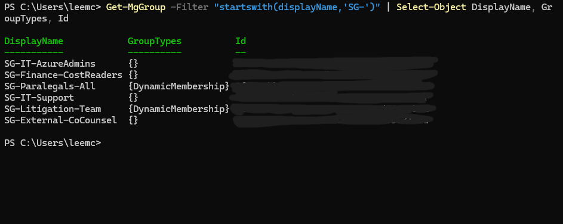

Dynamic membership populated from user attributes, with no manual adds:

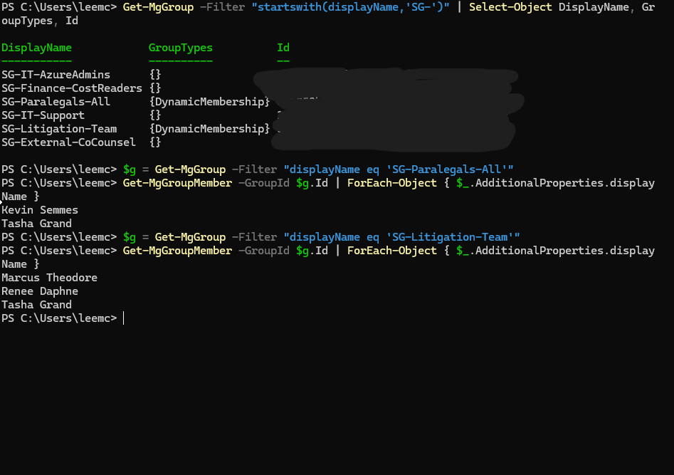

---

### Task 3 – Azure RBAC (R3, R5)

| Group | Role | Scope |
|---|---|---|
| `SG-IT-AzureAdmins` | Contributor | Subscription |
| `SG-Litigation-Team` | Reader | `rg-litigation-prod-01` |
| `SG-Finance-CostReaders` | Cost Management Reader | Subscription |

```bash
az role assignment create --assignee-object-id $LIT --assignee-principal-type Group \
  --role "Reader" --scope /subscriptions/$SUB/resourceGroups/rg-litigation-prod-01
```

**Verifying Owen's access.** The portal let Owen fill out the entire budget form. The denial came only when the request reached Azure Resource Manager:

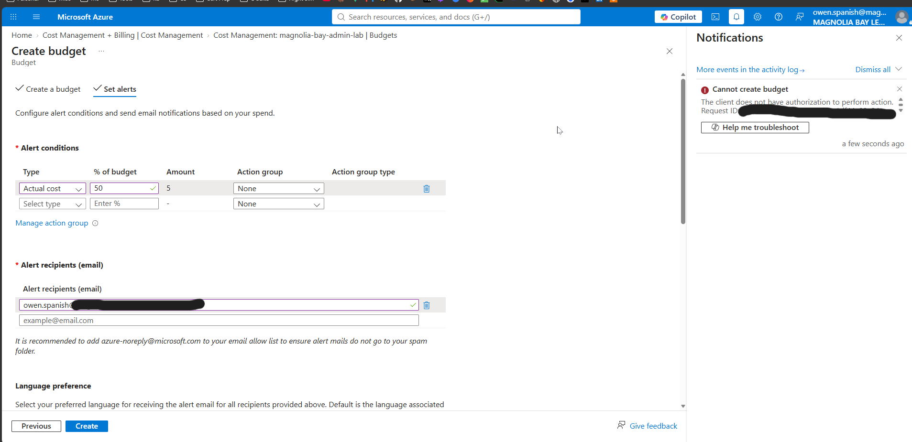

---

### Task 4 – Limited powers for Jordan (R4)

#### Part A – Helpdesk Administrator (Entra ID role, directory scope)

Assigned to the role-assignable `SG-IT-Support` group. The portal assignment failed through PIM ("The role is not found"), so I assigned it directly through the Microsoft Graph API. See [Troubleshooting](#7-troubleshooting-log).

```bash
az rest --method POST \
  --url "https://graph.microsoft.com/v1.0/roleManagement/directory/roleAssignments" \
  --headers "Content-Type=application/json" \
  --body "{\"principalId\":\"$GROUP\",\"roleDefinitionId\":\"$ROLE\",\"directoryScopeId\":\"/\"}"
```

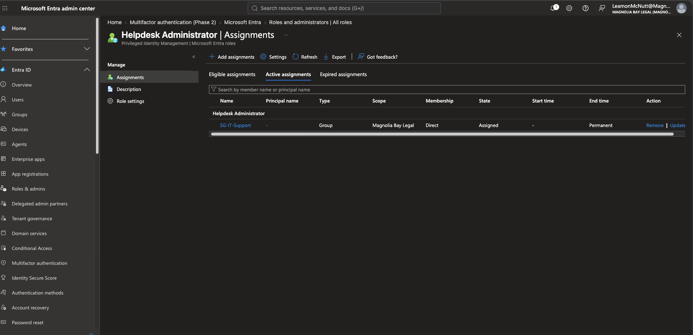

Jordan can reset a standard user's password:

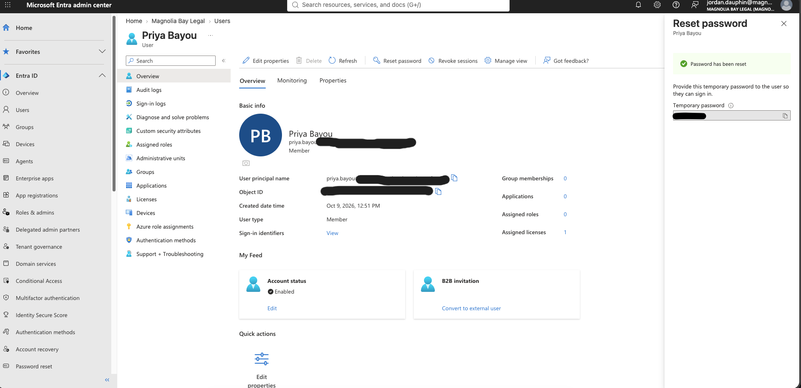

But he can't reset an administrator's password:

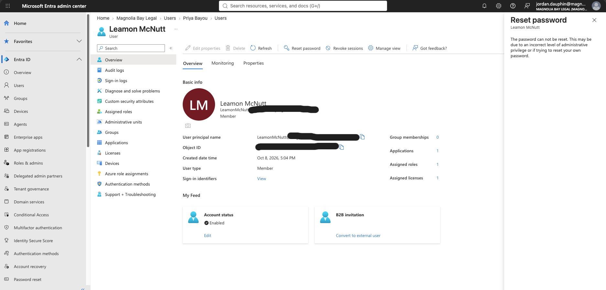

#### Part B – Custom `VM Operator` role (Azure RBAC)

No built-in role allows "start and restart VMs but nothing else," so I wrote a custom role: [`role-definitions/vm-operator.json`](role-definitions/vm-operator.json)

```json
"Actions": [
  "Microsoft.Compute/virtualMachines/read",
  "Microsoft.Compute/virtualMachines/start/action",
  "Microsoft.Compute/virtualMachines/restart/action",
  "Microsoft.Compute/virtualMachines/deallocate/action",
  "Microsoft.Resources/subscriptions/resourceGroups/read"
]
```

The role is *assignable* across the subscription but *assigned* only on `rg-servers-prod-01`:

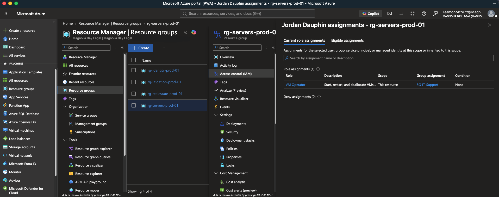

**Test VM:** Ubuntu, `Standard_D2alds_v7` (B-series had no capacity in East US), no public IP, no NSG, auto-shutdown on, disk and NIC set to delete with the VM. Deleted the same day.

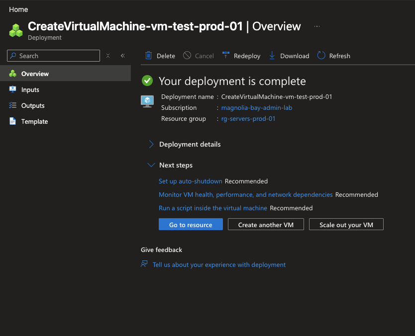

Jordan's allowed operations succeeded:

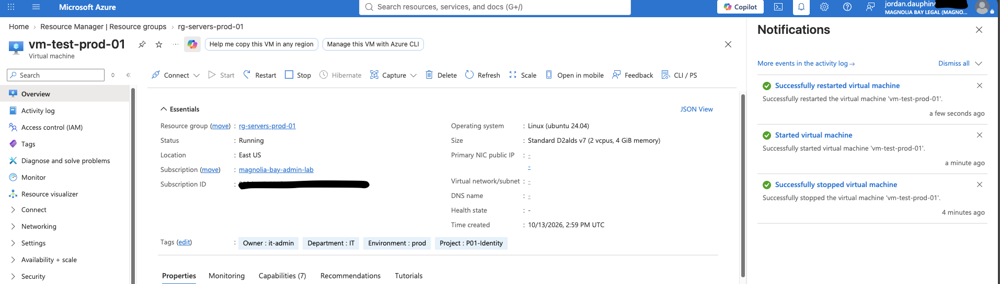

Everything else was denied, and each error names the exact permission Azure checked:

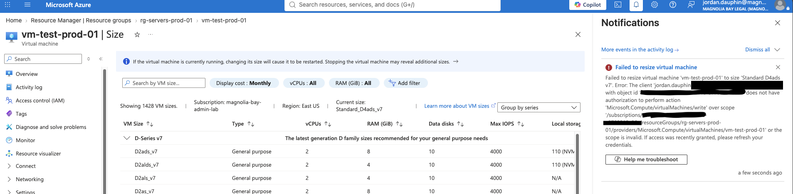

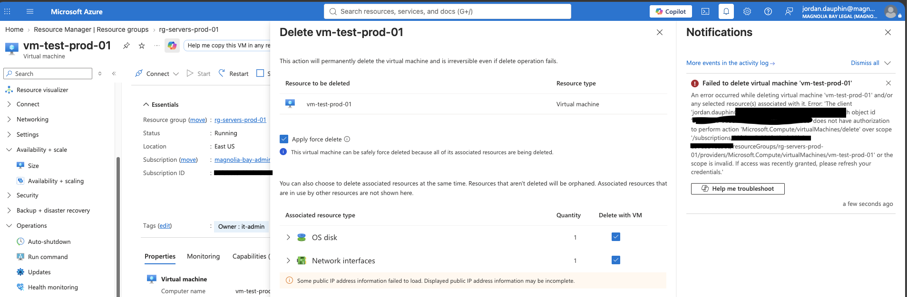

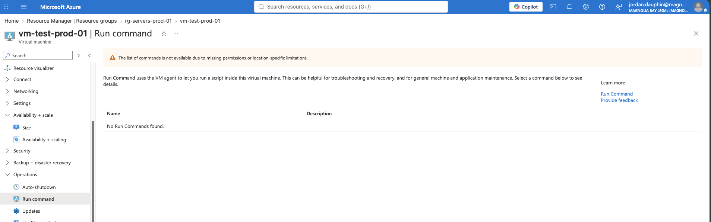

---

### Task 5 – External co-counsel as a B2B guest (R6)

Invited the co-counsel attorney as a guest (display name includes their firm), added them to `SG-External-CoCounsel`, and assigned that group **Reader** on `rg-litigation-prod-01`.

The guest initially saw an empty portal, which is ticket T3: guests land in their *home* directory. A tenant-specific URL (`portal.azure.com/<tenant>.onmicrosoft.com`) took them straight into ours:

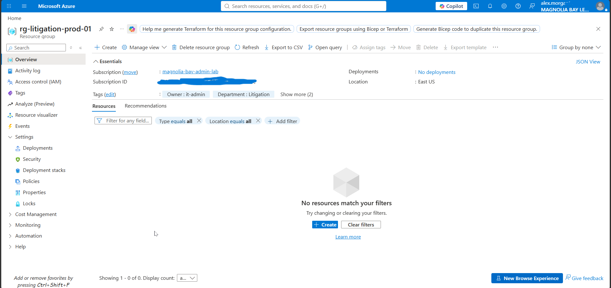

Default guest restrictions prevent browsing the staff directory:

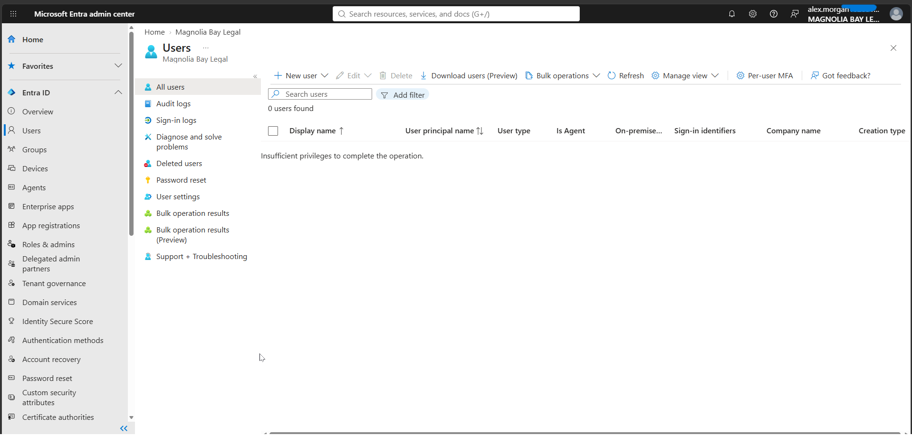

---

### Task 6 – Offboarding Kevin (R7)

**Before:** recorded his group memberships and license for later comparison.

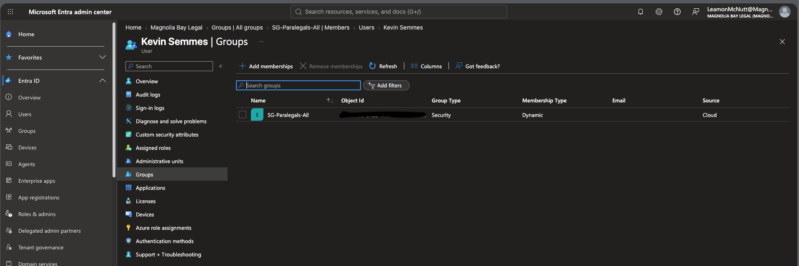

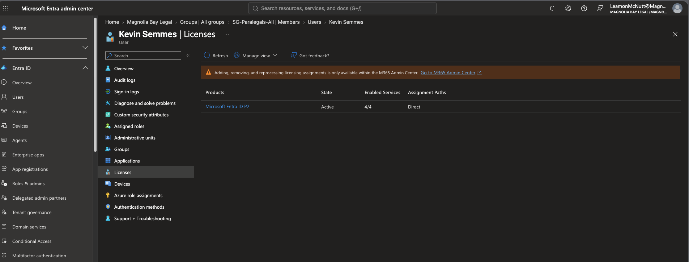

**Steps, in order:**

1. **Blocked sign-in.** Stops new logins.
2. **Revoked sessions.** Invalidates existing refresh tokens. Done second so he couldn't simply sign in again.
3. **Tested the lockout:**

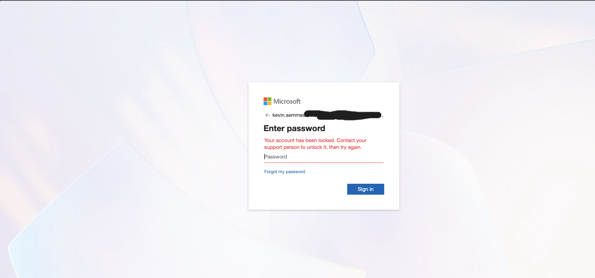

4. **Changed Department to `Former Employee`.** He dropped out of `SG-Paralegals-All` automatically:

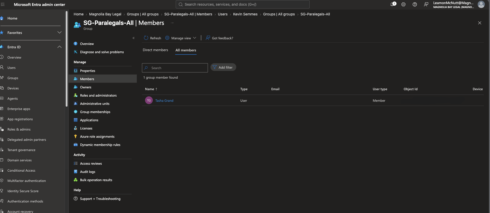

5. **Removed assigned groups.** None. His only membership was dynamic, which the attribute change already handled.
6. **Deleted the account.** It's held in Deleted users for 30 days:

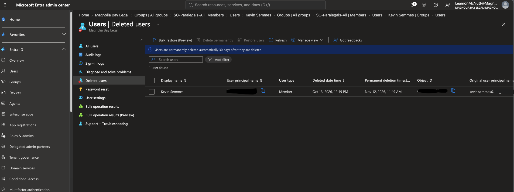

7. **Restored** when the managing partner needed his files for a case:

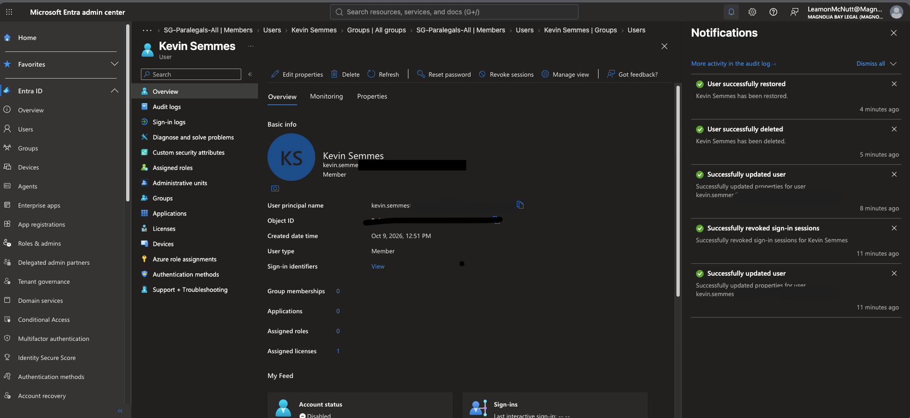

The restore brought back the **same object** with its license. It also brought back the **disabled** state, which is what the firm needs: Kevin's files are accessible to the firm, but Kevin can't sign in. Because his department is still `Former Employee`, he correctly stays out of the dynamic group.

---

## 5. Access Matrix

*Verified with `az role assignment list`, Graph role assignment queries, Check access, and sign-in tests as each user.*

| Group / Account | Members | Entra ID role (directory) | Azure role | Scope |
|---|---|---|---|---|
| `SG-IT-AzureAdmins` | IT admin account | — | Contributor | Subscription |
| `SG-IT-Support` | Jordan Dauphin | Helpdesk Administrator | VM Operator *(custom)* | `rg-servers-prod-01` |
| `SG-Finance-CostReaders` | Owen Spanish | — | Cost Management Reader | Subscription |
| `SG-Litigation-Team` *(dynamic)* | Marcus Theodore, Renee Daphne, Tasha Grand | — | Reader | `rg-litigation-prod-01` |
| `SG-External-CoCounsel` | Co-counsel guest (Whitfield & Ames) | — | Reader | `rg-litigation-prod-01` |
| `SG-Paralegals-All` *(dynamic)* | Tasha Grand | — | None yet *(reserved for case-file storage, Project 03)* | — |
| **IT admin account** *(direct)* | — | Global Administrator | Owner | Subscription |
| **Kevin Semmes** | — | — | None. Disabled, restored for file access only | — |
| Diane, Carlos, Priya, Gina | — | — | None *(no business need yet)* | — |

### Summary for the managing partner

> Every staff member now has their own account, and nobody shares logins. Access is granted by role, not by person, so when someone joins, changes jobs, or leaves, their access updates in one place.
>
> - **IT** manages the Azure environment. Jordan can reset staff passwords and restart servers, but can't create, delete, or change anything, or reset an administrator's password.
> - **Owen** can see what Azure costs and can't change anything.
> - **The litigation team** and **co-counsel** can view litigation resources only. Co-counsel signs in with their own firm's account, and their access ends with one click when the case closes.
> - **Kevin's** account was locked out on his last day. It's been restored only so his files can be retrieved; he can't sign in.
> - All accounts require multi-factor authentication.
>
> Every permission was tested by signing in as each person, not just configured.

---

## 6. Validation

All tests run in InPrivate windows, signed in as each user.

| Test | Expected | Result |
|---|---|---|
| Tasha opens the Azure portal | Sees `rg-litigation-prod-01` only, read-only | ✅ Pass |
| Kevin's department changed | Removed from `SG-Paralegals-All` automatically | ✅ Pass |
| Jordan resets Priya's password | Succeeds | ✅ Pass |
| Jordan resets the admin's password | Blocked | ✅ Pass |
| Jordan restarts / stops / starts a VM | Succeeds | ✅ Pass |
| Jordan resizes a VM | Denied (`virtualMachines/write`) | ✅ Pass |
| Jordan deletes a VM | Denied (`virtualMachines/delete`) | ✅ Pass |
| Jordan uses Run command | Denied | ✅ Pass |
| Owen creates a budget | Denied | ✅ Pass |
| Guest signs in | Sees only `rg-litigation-prod-01`; can't browse users | ✅ Pass |
| Kevin signs in after offboarding | Blocked | ✅ Pass |
| Kevin restored from Deleted users | Same object and license; remains disabled and outside dynamic groups | ✅ Pass |

---

## 7. Troubleshooting Log

| Issue | What I checked | Root cause | Fix |
|---|---|---|---|
| Couldn't create resource groups as the new admin account | Directories + subscriptions; Manage tenants | Activating the P2 trial created a **separate tenant** with no subscription | Evaluated moving my existing subscription (would have broken CI/CD and identity-based connections for live workloads). Chose a separate lab subscription instead |
| `az group list` returned 3 of 4 resource groups with no Dept column | Spelling in the JMESPath query; tags on the missing RG | Typo (`tage` vs `tags`). JMESPath returns nothing for unknown fields instead of an error | Fixed the query; verified all four RGs and tags |
| `Update-MgUser` not recognized (Cloud Shell) | `Get-Module -ListAvailable Microsoft.Graph*` | `Microsoft.Graph.Users` wasn't installed (only `Users.Actions` and `Users.Functions`) | Installed `Microsoft.Graph.Users` pinned to the same version as the other Graph modules |
| `Connect-MgGraph` not recognized (Windows) | Shell version; module path | Graph modules are per machine; Windows PowerShell 5.1 had none | Installed modules with `-Scope CurrentUser`; connected with `-TenantId` to avoid landing in the wrong tenant |
| `Connect-MgGraph` failed on macOS: `System.Text.Json, Version=10.0.0.0` | PowerShell version (7.5.4) vs. Graph module version (2.41.1) | Newer Graph module built against a newer .NET than the installed PowerShell runtime | Finished on a known-good machine; would pin Graph to 2.40.0 on macOS until PowerShell catches up |
| Helpdesk Administrator assignment failed: **"The role is not found"** | Error subtitle (Privileged Identity Management); `isAssignableToRole` via Graph (`true`) | PIM portal path failing in a newly activated P2 tenant. The group was configured correctly | Assigned the role directly through the Graph role management API with `az rest` |
| `Connect-MgGraph` from Cloud Shell blocked: **AADSTS 530035** | Error details; sign-in logs | Security defaults blocked the **device code flow** (started in Cloud Shell, completed on another device), a pattern used in device code phishing | Called Graph through the existing Azure CLI session (`az rest`) instead of starting a new device code sign-in |
| Guest saw an empty Azure portal (T3) | Directory shown in the portal header | Guests land in their home directory by default | Switched directory / used the tenant-specific portal URL |
| `az vm create` failed with a long Python traceback | First `Code:` / `Message:` lines in the output | **SkuNotAvailable**: no capacity for `Standard_B1s` in East US. The traceback was the CLI crashing while printing the error | Checked available sizes; deployed an available D-series size and deleted it the same day |

---

## 8. Why I Made These Choices


- **Groups, not individuals.** Every permission is assigned to a group, so onboarding, role changes, and offboarding are one membership change, and the access matrix stays accurate. The one exception, my own admin account, is documented in the matrix instead of hidden.
- **Dynamic groups.** Paralegals and the litigation team are populated from HR attributes, so access follows the person when their department or title changes. Kevin's offboarding proved it: one attribute change removed his access.
- **Contributor, not Owner, for the admin group.** Contributor can manage every resource but can't grant access to anyone. If an admin account is compromised, it can't be used to create backdoor role assignments.
- **Two permission systems, used deliberately.** Jordan's password-reset power is an **Entra ID role** (directory scope). His server power is **Azure RBAC** (resource group scope). They're separate systems with separate scopes, and the ticket needed both.
- **Helpdesk Administrator, not Global Administrator.** A compromised helpdesk account can reset passwords for regular staff but not for administrators, so it can't be used to take over the tenant.
- **A custom role instead of a built-in.** Reader was too little and Virtual Machine Contributor was too much. The custom role grants exactly three power operations. Leaving out `write` blocks resizing and every other configuration change; leaving out `runCommand/action` means Jordan can operate servers but can't execute code on them.
- **Accepted trade-off:** with VM Operator, Jordan can't see the VM's network or disk details. I left those reads out because his job is restarting servers, not troubleshooting networking. If that changes, I'd add `Microsoft.Network/networkInterfaces/read` and `Microsoft.Compute/disks/read`.
- **A separate group for external access.** Keeping the guest out of `SG-Litigation-Team` makes all outside access visible in one place and removable in one step when the case closes.
- **Block, then revoke.** Blocking sign-in stops new logins; revoking sessions kills existing refresh tokens. Revoking first would have left a window to sign in again.
- **A separate lab subscription.** Rather than move my existing subscription between tenants (which would have broken live workloads), I isolated the lab. It's the same reason companies separate production from test environments.

---

## 9. Lessons Learned


- **Test the action, not the interface.** The portal let Owen fill out a full budget form and let the guest click Delete. Enforcement happens server-side, so the denial message is the real evidence, not a greyed-out button.
- **Read past the first error.** "The role is not found" was really a PIM problem. A wall of Python traceback was really one `SkuNotAvailable` line. Finding which service threw the error, and its actual code, solved both.
- **Same command, different failures.** One Graph command failed three different ways on three machines: not installed, not authenticated, and a .NET dependency mismatch. "Not recognized," "authentication needed," and "could not load assembly" each point to a different fix.
- **Security controls show up as errors.** The 530035 block was security defaults stopping a sign-in pattern that matches device code phishing. Knowing *why* something is blocked matters more than getting around it.
- **Restores restore everything, including state.** Kevin came back disabled, which was the right outcome, but only because the account was disabled before it was deleted.
- **Clean up the same day.** The test VM was deployed, tested, and deleted in one sitting, and the resource group was verified empty afterward.

---


