# Project 02 – Governance Guardrails: Policy, Tags, Locks & Budgets

**Domain:** Manage Azure identities and governance (AZ-104)
**Company:** [Magnolia Bay Legal Group](../00-company-scenario/README.md)
**Business priorities addressed:** #2 Know who has access to what · #4 Don't surprise us with the bill
**Builds on:** [Project 01](../01-identity-governance/README.md) (resource groups, groups, and RBAC)
**Tools used:** Azure portal, Azure Cloud Shell (Azure CLI)
**Built:** November 1–6, 2026
**Actual cost:** $____ *(Azure Policy, tags, locks, and budgets are free; denied deployments never create resources)*

> **Lab note:** Magnolia Bay Legal Group is fictional. This project was built in a dedicated lab subscription. Subscription IDs, tenant IDs, object IDs, domains, and email addresses are redacted in all screenshots.
>
> **Second build:** I built this project once, tore it down to a verified clean slate, and rebuilt it so every step is documented as it happened. Where the first build's mistakes changed my approach, I say so.

---

## 1. The Ticket

> **From:** Owen Spanish, Billing Coordinator
> **CC:** Diane Fairhope, Managing Partner
> **To:** IT
> **Subject:** Azure costs and "who owns this?"
>
> I've been looking at the Azure bill now that I can see it. A few things:
>
> - I can't tell which department is spending what. Some items have a department listed and some don't.
> - Diane wants a monthly spending limit, and she wants to hear about it **before** we hit it, not after.
> - I saw a charge for a server size I've never heard of. Can we stop people from picking expensive ones?
> - Our malpractice carrier says client data has to stay in the U.S. Can you guarantee nothing gets created overseas?
>
> **Diane added:** Last month at my old firm someone deleted the production file server by accident. I want our important stuff protected from that, even from IT.

---

## 2. Requirements & Results

| ID | Requirement | Result |
|---|---|---|
| R1 | Resources only in approved U.S. regions | ✅ Two location policies (resources and resource groups); UK South denied |
| R2 | Only approved, cost-effective VM sizes | ✅ 4 small sizes (~$7–$70/month Linux); `Standard_D64s_v5` denied with nothing created |
| R3 | Every resource group has a `Department` tag | ✅ Untagged RG denied. Gap found and documented (see Task 3) |
| R4 | Resources inherit `Department` from their RG | ✅ New resources tagged at creation; existing resources fixed by remediation |
| R5 | One managed baseline | ✅ `Magnolia Bay Baseline` initiative: 5 policies, 3 parameters, 1 assignment |
| R6 | Production protected from accidental deletion | ✅ Delete locks; Owner's delete fails with `ScopeLocked` |
| R7 | Monthly budget with early warnings | ✅ $20/month budget, 4 alert conditions, 2 action groups |
| R8 | Documented, time-limited exception process | ✅ 30-day Waiver exemption for one policy on one RG |

---

## 3. Environment

| Item | Value |
|---|---|
| Subscription | `magnolia-bay-admin-lab` |
| Policy scope | Subscription |
| Approved regions | East US, Central US |
| Approved VM sizes | `Standard_B2ats_v2`, `Standard_B2als_v2`, `Standard_B2s_v2`, `Standard_D2alds_v7` |
| Required tag | `Department` on resource groups, inherited by resources |
| Locked resource groups | `rg-identity-prod-01`, `rg-litigation-prod-01` |
| Budget | `budget-magnolia-monthly`, $20/month, subscription scope |

---

## 4. Build

> **Timing:** a new policy assignment can take up to 30 minutes to take effect. I recorded the time of every assignment and waited 15–20 minutes before testing.

### Task 1 – Allowed locations (R1)

Azure has two built-in location policies, and each covers only half of the problem:

| Policy | Checks | Misses |
|---|---|---|
| **Allowed locations** | Resources | Resource groups (the policy's *Indexed* mode skips them) |
| **Allowed locations for resource groups** | Resource groups | Resources inside them |

A resource group's location only stores its metadata, so an RG in East US can still hold a storage account in UK South. I assigned both: the first in the portal, the second with the CLI.

**Approved regions:** East US and Central US. Central US gives the firm a second U.S. region for future backup or failover without loosening the policy.

```bash
DEF=$(az policy definition list \
  --query "[?displayName=='Allowed locations for resource groups'].name" -o tsv)
echo "DEF=$DEF"

az policy assignment create --name mb-allowed-locations-rg \
  --display-name "MB - Allowed locations for resource groups" \
  --policy "$DEF" --scope "/subscriptions/$SUB" \
  --params '{"listOfAllowedLocations":{"value":["eastus","centralus"]}}'

az policy assignment non-compliance-message create --name mb-allowed-locations-rg \
  --scope "/subscriptions/$SUB" \
  --message "Magnolia Bay policy: resource groups must be created in East US or Central US. Contact IT for exceptions."
```

Each assignment has a **non-compliance message**, so a blocked user sees what to do instead of a cryptic policy error.

**The first test failed.** A storage account was created in UK South. The assignment had been saved with enforcement mode **Enroll** (see the [Troubleshooting Log](#7-troubleshooting-log)). After I set it to `Default`, every test passed.

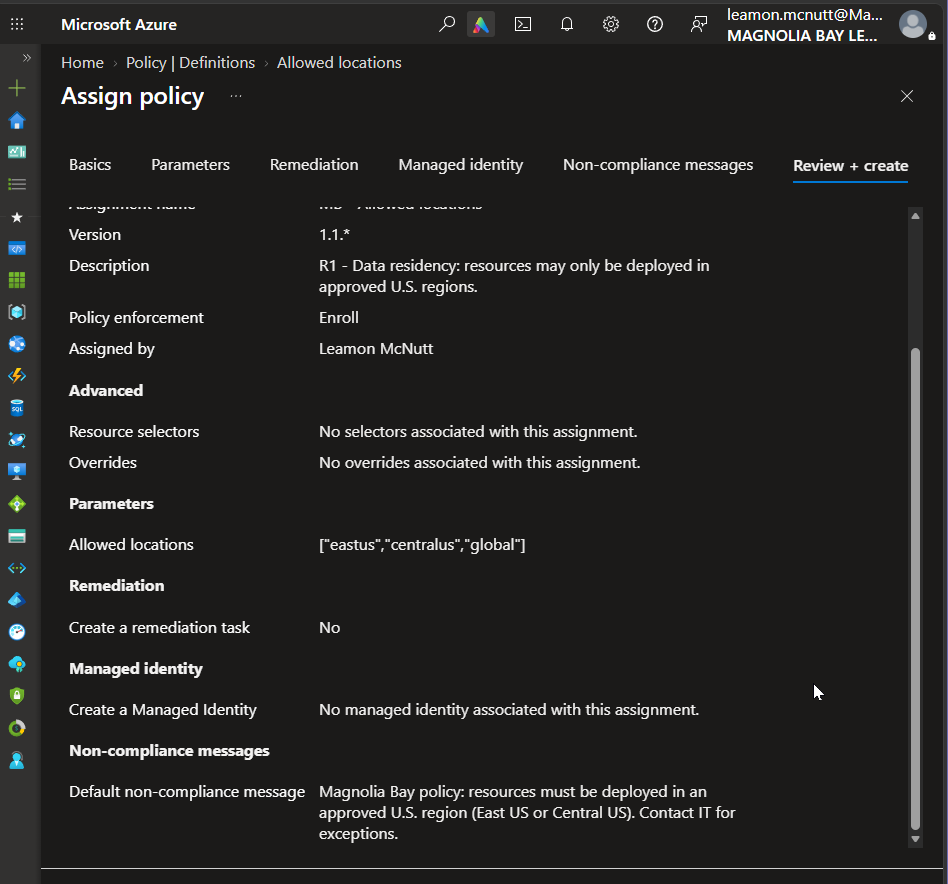
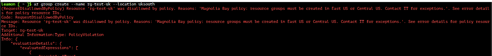
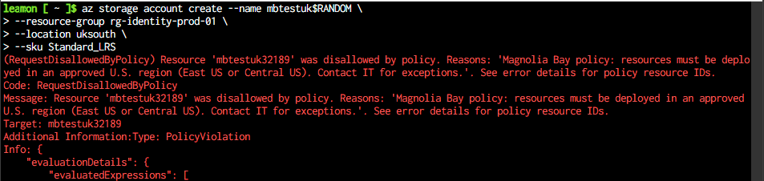
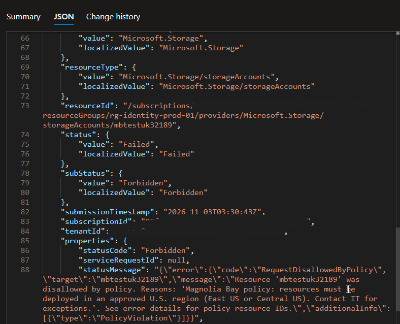
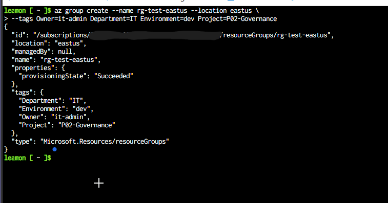

---

### Task 2 – Allowed VM sizes (R2)

Policy controls **what** can be created; RBAC controls **who** can create it. Anyone who can create a VM can pick any size, so only Policy can answer Owen's "expensive server" complaint.

I chose sizes from what my subscription can actually deploy, not from a pricing page:

```bash
az vm list-skus --location eastus --resource-type virtualMachines --size Standard_B --output table
az vm list-skus --location eastus --resource-type virtualMachines --size Standard_D2 --output table
```

**Two things I noticed in the output:**
- `--size` is a **prefix** match. The `Standard_D2` search returned `Standard_D248ds_v7`, a 248-vCPU machine. Copying names without reading them could have allowed one of the largest VMs Azure sells.
- Some restrictions apply to a single availability zone (`NotAvailableForSubscription, type: Zone, zones: 1`).

| Size | Specs | Linux (East US) | Windows (East US) | Central US |
|---|---|---|---|---|
| `Standard_B2ats_v2` | 2 vCPU, 1 GiB, burstable | ~$6.86/mo | ~$10.66/mo | ~$7.74/mo |
| `Standard_B2als_v2` | 2 vCPU, 4 GiB, burstable | ~$27.45/mo | ~$34–35/mo | ~$31.03/mo |
| `Standard_B2s_v2` | 2 vCPU, 8 GiB, burstable | ~$60.74/mo | ~$67.45/mo | ~$63–66/mo |
| `Standard_D2alds_v7` | 2 vCPU, 4 GiB, steady CPU | ~$69.50/mo | ~$136.51/mo | ~$69.50/mo |

✏️ *Confirm the column headings match how you collected these prices.*

I excluded **Arm sizes** (`p` in the name, such as `B2pts_v2`), because they can't run standard Windows images or many Linux images.

**Tests (free):** `Standard_D64s_v5` was denied during validation, and `az resource list` confirmed nothing was created. Azure checks the whole deployment template against policy before building any of it. An allowed size passed portal validation.

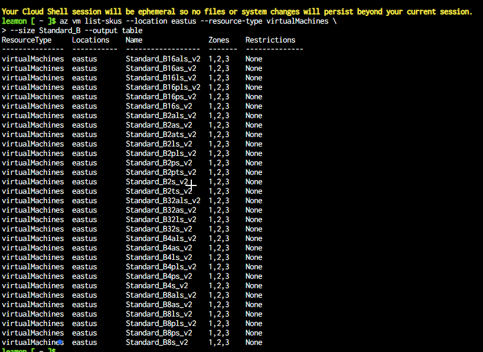
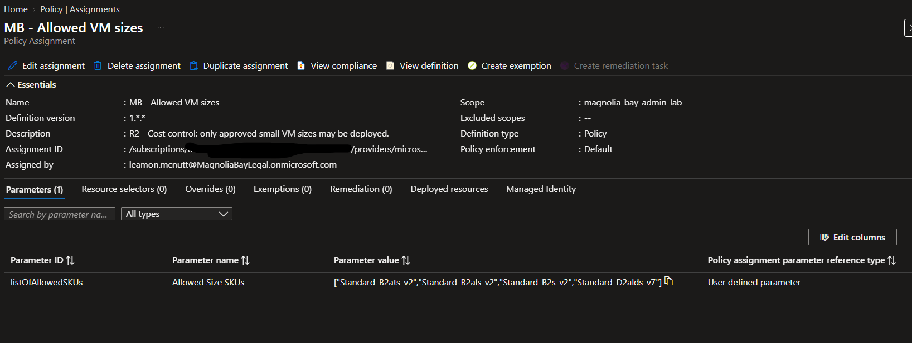
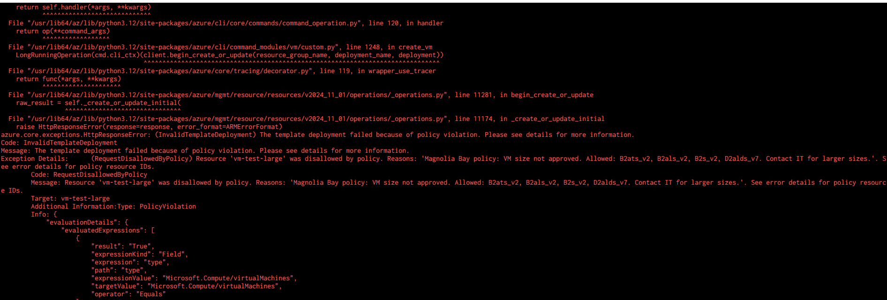


---

### Task 3 – Require a Department tag on resource groups (R3)

Owen can only report spending by department if costs carry a `Department` tag. The tag is required on **resource groups only**: many resources are created automatically by other services, and requiring tags on them breaks deployments. Task 4 handles resources by inheritance.

| Test | Expected | Result |
|---|---|---|
| RG with no tag | Denied | ✅ Denied |
| RG with `Department=IT` | Allowed | ✅ Allowed |
| RG with `department=IT` (lowercase) | *Experiment* | Allowed |
| RG with `Department=asdf` | *Experiment* | Allowed |

**Finding: the control works as designed, but the design has a gap.**
- **Capitalization:** the policy treats tag names as case-insensitive, but Azure stores the name exactly as typed. The lowercase RG is compliant with policy, yet a case-sensitive query such as `tags.Department` misses it. *Compliant isn't the same as consistent.*
- **Values:** the policy only checks that the tag exists. `Department=asdf` is compliant, and Owen's cost report would show an "asdf" department.
- **Fix (future work):** a custom policy that denies any `Department` value not in an approved list.

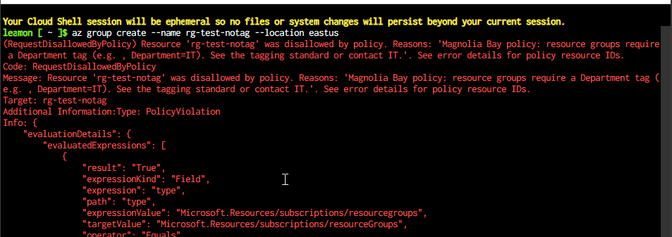
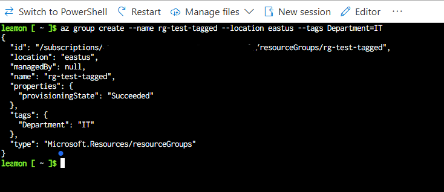

---

### Task 4 – Inherit the Department tag (R4)

**Inherit a tag from the resource group if missing** uses the **Modify** effect: it changes the request to add the tag instead of blocking it.

| Effect | New requests | Existing resources |
|---|---|---|
| Deny | Rejected | Flagged non-compliant |
| Audit | Allowed and logged | Flagged |
| **Modify** | **Changed, then allowed** | Flagged, fixed by **remediation** |

I chose the **"if missing"** version, not the version that overwrites, so a deliberately different tag on a resource is never replaced.

**Managed identity:** to change existing resources, the assignment needs an identity with write permission. The portal grants the role listed in the definition's `roleDefinitionIds`, which for this built-in is **Contributor**. Tag Contributor would be enough; in production I'd use a custom copy of the definition with the smaller role.

**Order matters:** in the first build, I created the remediation task together with the assignment and it fixed **0 resources**. A remediation task fixes only resources a compliance scan has already marked non-compliant. This time: **assign → scan → remediate.**

```bash
# 1. Untagged resource BEFORE the policy
az network nsg create -g rg-litigation-prod-01 -n nsg-test-before --location eastus

# 2. Assign (portal, identity created, no remediation task), wait, then scan
az policy state trigger-scan --resource-group rg-litigation-prod-01
az policy state list --resource-group rg-litigation-prod-01 \
  --query "[?contains(resourceId,'nsg-test-before')].{Resource:resourceId, State:complianceState}" -o table

# 3. Remediate
az policy remediation create --name rem-inherit-department \
  --policy-assignment "/subscriptions/$SUB/providers/Microsoft.Authorization/policyAssignments/$ASSIGN"

# 4. New resource AFTER the policy
az network nsg create -g rg-litigation-prod-01 -n nsg-test-after --location eastus
```

**Who made each change? (Activity log)**

| Resource | How it was tagged | Caller | Operation |
|---|---|---|---|
| `nsg-test-after` | At creation | **Me** | `networkSecurityGroups/write` |
| `nsg-test-before` | By remediation | **Policy managed identity** | `Microsoft.Resources/tags/write` |

Modify edits the request in transit, so a new resource is tagged as part of *my* operation. Remediation tags existing resources through the tags API using the policy's own identity. I confirmed it by matching the caller GUID in the Activity log to the assignment's `identity.principalId`.

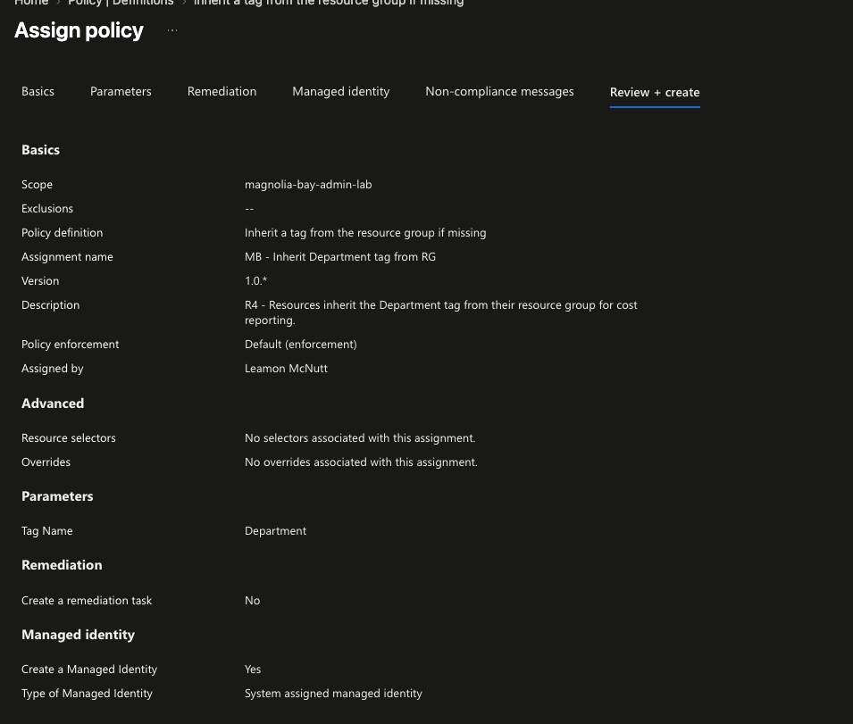
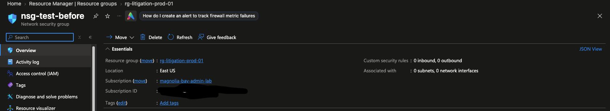
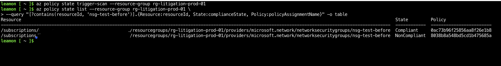


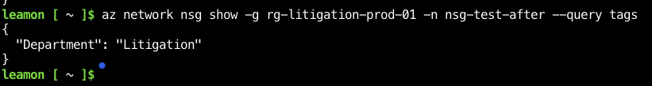
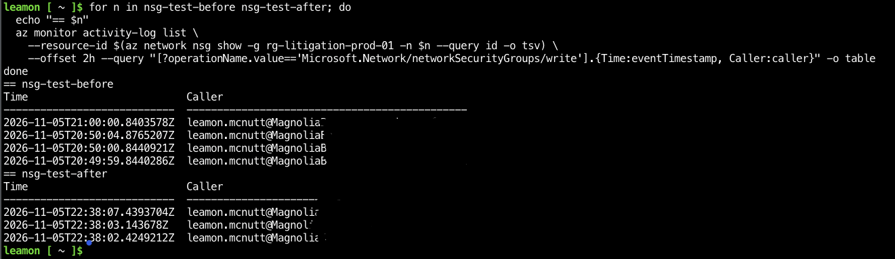

---

### Task 5 – Magnolia Bay Baseline initiative (R5)

Four assignments became one: one definition, one assignment (`MB-Baseline`), one compliance score.

| # | Policy | Initiative parameter |
|---|---|---|
| 1 | Allowed locations | `allowedLocations` |
| 2 | Allowed locations for resource groups | `allowedLocations` |
| 3 | Allowed virtual machine size SKUs | `allowedVmSizes` |
| 4 | Require a tag on resource groups | `tagName` |
| 5 | Inherit a tag from the resource group if missing | `tagName` |

| Parameter | Type | Default |
|---|---|---|
| `allowedLocations` | Array | `["eastus","centralus"]` |
| `allowedVmSizes` | Array | `["Standard_B2ats_v2","Standard_B2als_v2","Standard_B2s_v2","Standard_D2alds_v7"]` |
| `tagName` | String | `Department` |

Both location policies share one parameter, so adding a region later is one change and the two can't drift apart.

**Cutover without a gap:** I assigned and verified the initiative **before** removing the old assignments. Deleting them first would have left up to 30 minutes with nothing enforced.

**No orphaned identity this time:** deleting a policy assignment deletes its managed identity but **not** that identity's role assignment, which is how the first build ended up with an "Identity not found" Contributor assignment. I saved the old identity's `principalId`, removed its role assignment, then deleted the policy assignment.

```bash
OLDPID=$(az policy assignment show --name "$OLD" --scope "/subscriptions/$SUB" \
  --query identity.principalId -o tsv)
echo "OLD=$OLD  OLDPID=$OLDPID"     # stop if either is empty
az role assignment delete --assignee "$OLDPID" --scope "/subscriptions/$SUB"
az policy assignment delete --name "$OLD" --scope "/subscriptions/$SUB"
```

The initiative definition is in [`policy-definitions/magnolia-bay-baseline.json`](policy-definitions/magnolia-bay-baseline.json), with the subscription ID removed.

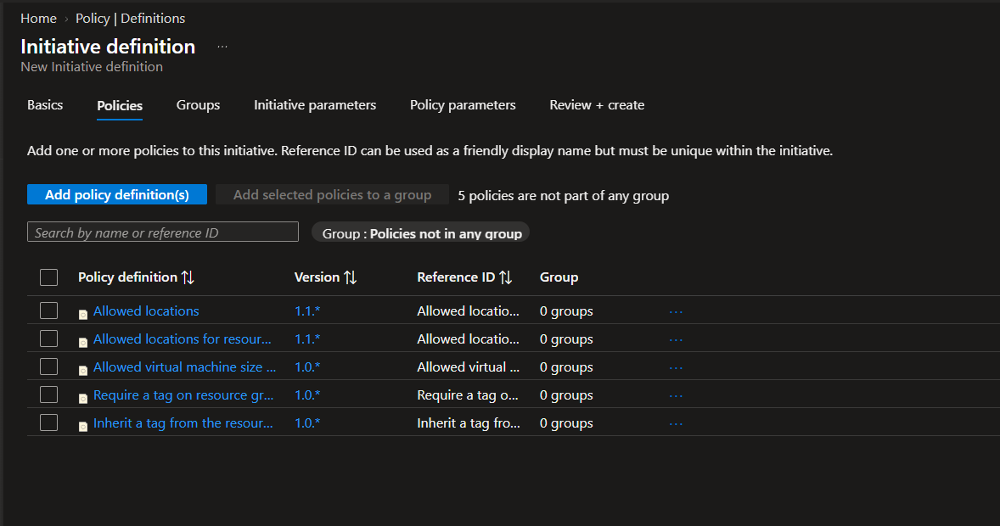
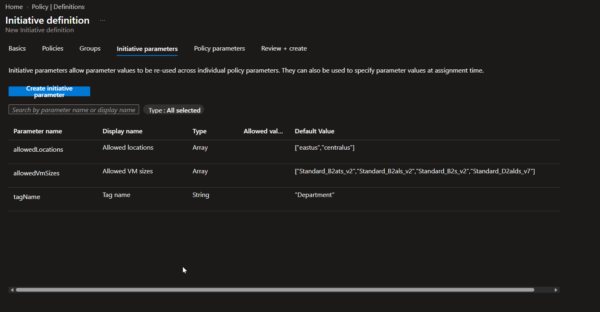
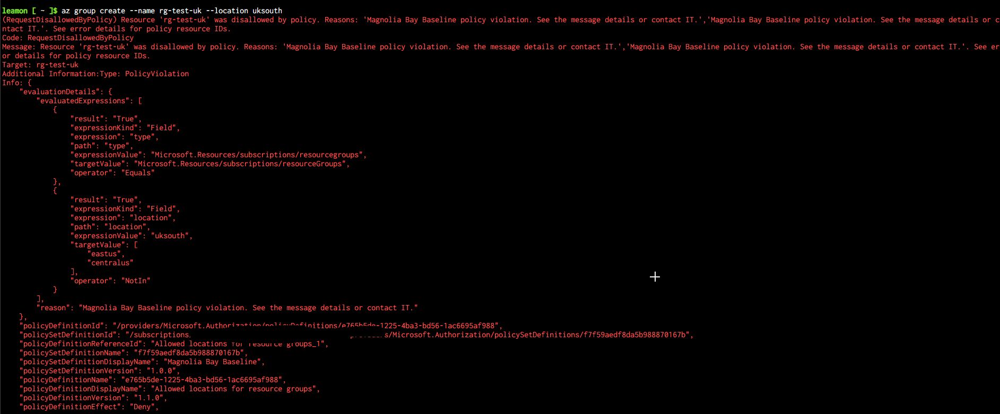
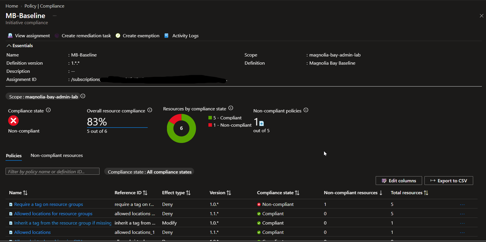

---

### Task 6 – Resource locks (R6)

| Control | Answers |
|---|---|
| RBAC | *Who* can do it? |
| Policy | *What* can be created? |
| **Lock** | *Is this action allowed on this resource at all, for anyone?* |

**Locks override RBAC:** even an Owner can't delete a locked resource without removing the lock first. Removing a lock requires `Microsoft.Authorization/locks/delete` (Owner or User Access Administrator), which **Contributor doesn't have**. So my admin group can't remove locks either.

| Resource group | Lock | Notes |
|---|---|---|
| `rg-identity-prod-01` | Delete | Prevent accidental deletion of identity resources. Removal requires Owner approval. |
| `rg-litigation-prod-01` | Delete | ✏️ *Prevent accidental deletion of litigation case resources. Removal requires Owner approval.* |

I tested on a disposable locked RG first, then on `rg-litigation-prod-01`. Both failed with `ScopeLocked`, and nothing was deleted.

**Read-only test (ticket T3):** with a ReadOnly lock, `az storage account keys list` failed with *"cannot perform write operation."* ReadOnly allows only GET requests. Retrieving keys is a POST (`.../listKeys`), as are VM start and restart. **A ReadOnly lock on `rg-servers-prod-01` would stop Jordan from restarting servers**, so that RG gets Delete at most.

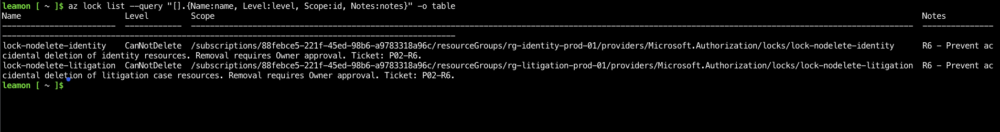
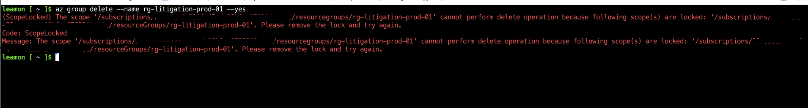
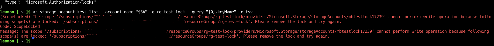

---

### Task 7 – Budget and alerts (R7)

**A budget only alerts. It never stops spending.** Azure won't shut anything down at 100%.

**Action groups** hold the recipient list, so it's maintained in one place:

| Action group | Recipients |
|---|---|
| `ag-cost-alerts` | IT, Owen |
| `ag-cost-alerts-escalation` | IT, Owen, Diane |

A budget condition takes one action group, so Diane's 100% notification needed its own escalation group. Lab users have no mailboxes, so I used email plus-addressing to deliver each "person's" copy to one inbox and confirmed with a test notification. Both action groups inherited `Department=IT` from the baseline policy automatically.

**Budget:** `budget-magnolia-monthly`, $20/month, **subscription scope**

| Type | Threshold | Action group |
|---|---|---|
| Actual | 50% | `ag-cost-alerts` |
| Actual | 80% | `ag-cost-alerts` |
| Actual | 100% | `ag-cost-alerts-escalation` |
| Forecasted | 100% | `ag-cost-alerts-escalation` |

**Scope matters:** in the first build, I created the budget at the **billing account** scope, where action groups aren't available. This time I created it from the subscription and confirmed the scope before filling in the form. The **forecasted** alert is the "before, not after" warning Diane asked for.

**Owen's test:** he can view the budget but can't edit it. The action group column shows an error for him, because Cost Management Reader can't read action groups. I left it that way: Owen needs to receive alerts, not see how they're routed.

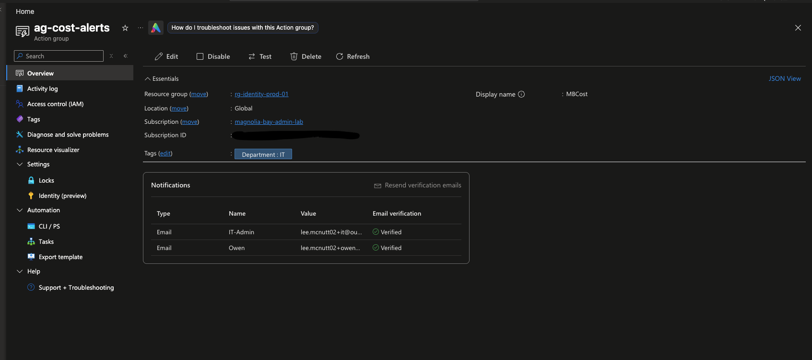
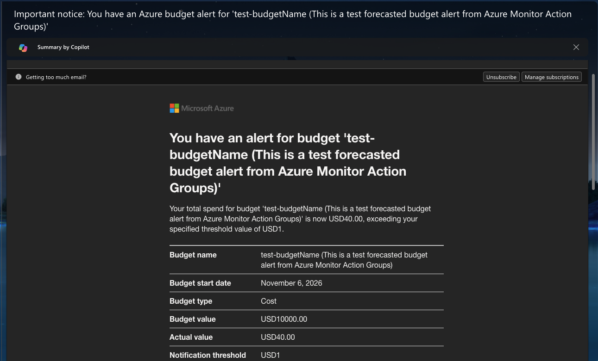
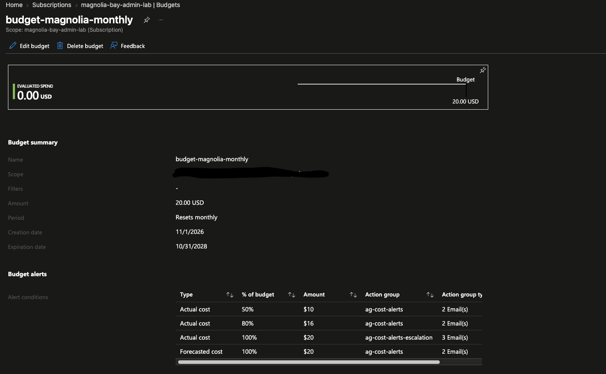
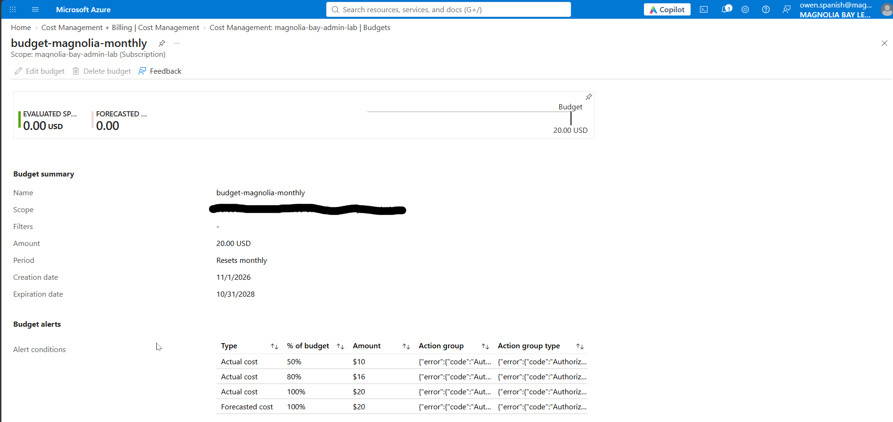

---

### Task 8 – Exemption for the e-discovery vendor (R8)

The vendor's appliance must run in **West US 2** for one case. Instead of weakening the baseline, I created an exemption:

| Setting | Value |
|---|---|
| Name | `EX-ediscovery-westus2` |
| Scope | `rg-ediscovery-lab-01` only |
| Policy exempted | Allowed locations (resources) only. Reference ID: ✏️ `<reference-id>` |
| Category | **Waiver** (risk accepted, not mitigated) |
| Expires | 30 days |
| Description | E-discovery vendor appliance requires West US 2 for the [case] matter. Approved by Diane Fairhope (Managing Partner) on 2026-11-06. Expires in 30 days; resources must be removed or relocated before then. Ticket: P02-R8. |

**Exemption vs. exclusion:** an exclusion (`notScopes`) would skip **every** policy in the assignment, with no expiration and no record of why. This exemption lifts one rule on one RG, expires on its own, and shows as **Exempt** on the compliance dashboard, where an auditor can see it.

| Test | Expected | Result |
|---|---|---|
| NSG in West US 2, exempted RG | Allowed | ✅ |
| NSG in West US 2, another RG | Denied | ✅ |
| Exempted NSG still inherits `Department` | Yes | ✅ |

The third test proves the exemption is narrow: the location rule was lifted, but the tag policy still applied.

**Kept to expire:** I'm letting the exemption expire to see the whole lifecycle. Expiration doesn't delete anything; the resources become non-compliant and keep running.

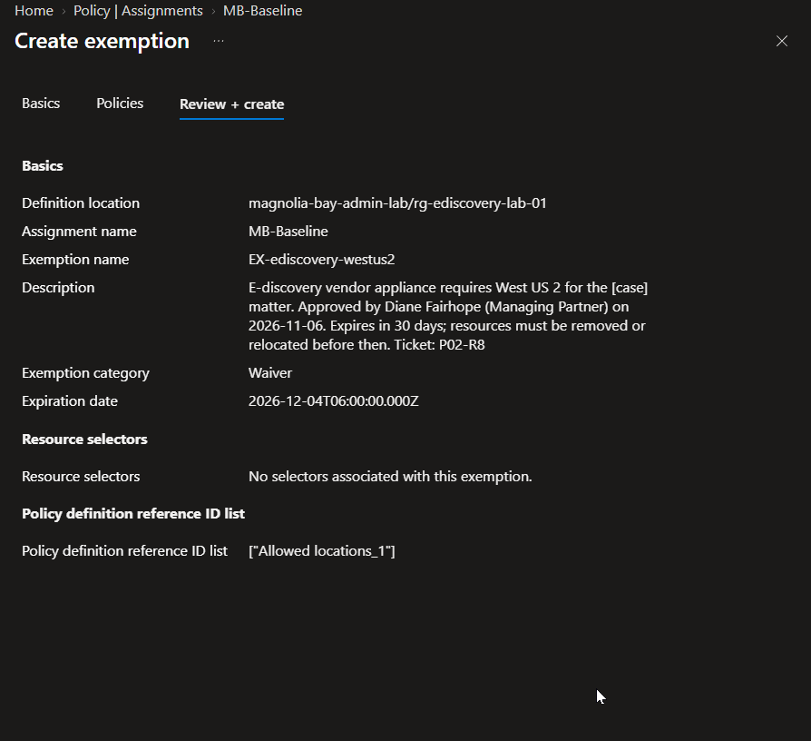
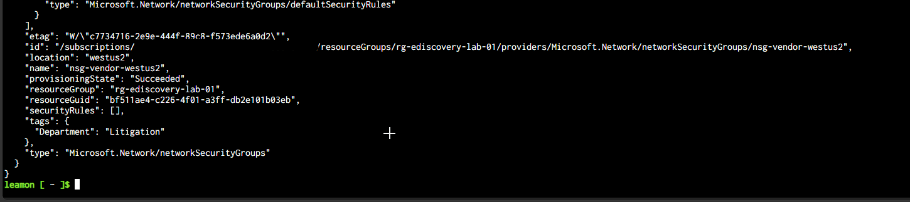
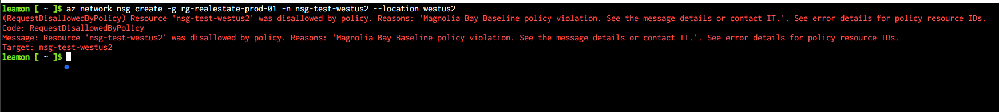
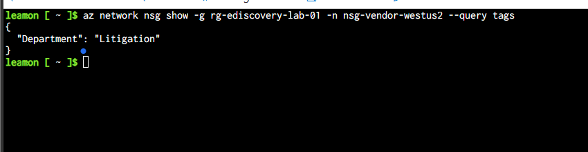

---

## 5. Validation

| Test | Expected | Result |
|---|---|---|
| RG in UK South | Denied | ✅ |
| Storage account in UK South | Denied (`RequestDisallowedByPolicy`) | ✅ |
| VM with a large size | Denied during validation, nothing created | ✅ |
| VM with an allowed size | Passes validation | ✅ |
| RG with no `Department` tag | Denied | ✅ |
| Existing untagged resource after remediation | Tagged; compliant | ✅ |
| New resource with no tags in `rg-litigation-prod-01` | Created with `Department=Litigation` | ✅ |
| Remediation caller | Policy managed identity | ✅ |
| Initiative compliance dashboard | One assignment, one score | ✅ |
| Owner deletes `rg-litigation-prod-01` | `ScopeLocked` | ✅ |
| List storage keys under a ReadOnly lock | Blocked | ✅ |
| Action group test email | Received | ✅ |
| Owen opens Budgets | Can view, can't edit | ✅ |
| West US 2 in `rg-ediscovery-lab-01` | Allowed; still denied elsewhere | ✅ |

---

## 6. Troubleshooting Tickets

**T1 – "You said overseas regions were blocked, but I just created something in UK South."**
This happened during the build. Two causes to check: **timing** (a new assignment takes up to 30 minutes) and **enforcement mode**. Mine was set to *Enroll*, which enforces only on scopes enrolled through a separate enrollment resource. See the Troubleshooting Log.

**T2 – "The dashboard says 40% of our resources are non-compliant, but nothing is broken."**
Deny and Modify policies act only on **new and updated** requests. Resources that existed before the assignment are reported as non-compliant, but they keep running. Modify and DeployIfNotExists policies can fix them with a **remediation task**; Deny and Audit can't, so those need manual cleanup or an exemption. In Task 4, `nsg-test-before` was non-compliant until remediation ran. Non-compliance is a report, not an outage.

**T3 – "Jordan can't restart the file server anymore."**
Jordan's role didn't change. A ReadOnly lock blocks every POST, and VM start and restart are POSTs. I reproduced it with `listKeys` in Task 6. Fix: replace the lock with a **Delete** lock, which protects the server without breaking Jordan's job.

**T4 – "Owen never got the budget alert email."**
Check in order: has spending actually reached a threshold? (A lab spends very little.) Has cost data caught up? (It lags 8–24 hours.) Is the action group's address correct? Is the alert in spam or junk? (Allow-list `azure-noreply@microsoft.com`.) Then send a **test notification** from the action group, which is how I proved delivery in Task 7.

---

## 7. Troubleshooting Log

> ✏️ *Rows 2–6 are drafted from issues during the build. Review them and delete any you don't want to show.*

| # | Task | Issue | What I checked | Root cause | Fix |
|---|---|---|---|---|---|
| 1 | 1 | Storage account created in UK South despite the Allowed locations policy | Listed assignments with enforcement mode, definition ID, parameters, and creation time; compared with the resource's creation time | Enforcement mode saved as **Enroll** in the portal, so it's enforced only on enrolled scopes, and none existed. Timing (23 min) ruled out as the primary cause. | Set enforcement to `Default`, deleted the non-compliant storage account, retested. Now I verify enforcement mode after every assignment. |
| 2 | 2 | `--size Standard_D2` returned a 248-vCPU size | Read the full output instead of copying names | `--size` is a prefix match | Filtered with `?name=='<size>'` for exact matches |
| 3 | 3 | Lowercase tag name and junk tag value both accepted | Ran experiments past the expected tests | The built-in policy checks only that the tag exists, case-insensitive | Documented as a gap; an allowed-values custom policy would close it |
| 4 | 4 | Activity log query didn't show the remediation's change | Removed the operation filter; widened the time window; matched case-insensitively with `grep -i` | Remediation writes through `Microsoft.Resources/tags/write`, not the resource's own write operation. A later query also missed it because the 4-hour window had moved past the event. | Searched the RG's log by resource name and confirmed the policy identity as the caller |
| 5 | 4 | `--resource-id: expected one argument` | The inner `$(az network nsg show ...)` | The NSG had already been deleted, so the substitution returned nothing | Queried the RG's Activity log, which keeps history for deleted resources |

---

## 8. Why I Made These Choices

> ✏️ *Draft based on your notes. Rewrite in your own words.*

- **Central US as a second region:** it gives the firm a backup or failover option without loosening the data-residency policy.
- **No Arm VM sizes:** they can't run standard Windows images or many Linux images, so allowing them invites failed deployments.
- **`D2alds_v7` stays on the list:** ✏️ *Explain why you kept a steady-CPU size that costs more than `B2s_v2`.*
- **Tags required on resource groups, inherited by resources:** requiring tags on every resource breaks services that create resources automatically.
- **"If missing" instead of overwrite:** a deliberate resource-level tag is never replaced.
- **Contributor accepted for the policy identity:** the built-in requests it; I documented that Tag Contributor would be enough.
- **Initiative before removing the old assignments:** no window without enforcement.
- **Delete locks, not ReadOnly:** ReadOnly would break routine operations like VM restarts.
- **Owen doesn't see action group routing:** least privilege. He needs the alerts, not the plumbing.
- **Escalation action group for 100%:** the partner hears about overspending, not routine thresholds.
- **Exemption, not exclusion:** one policy, one RG, an expiration date, and a visible record.

---

## 9. Lessons Learned

> ✏️ *Add your own.*

- Enforcement mode has three values, not two: **Default**, **DoNotEnforce**, and **Enroll**. Check it after every assignment instead of trusting the wizard.
- Modify tags new resources inline, so the caller is the person who made the request. Remediation tags existing resources with the policy's managed identity.
- An empty query result doesn't mean nothing happened. Check the time window, case sensitivity, and filters first.

---

## 10. Cleanup & Cost

- [ ] All test resource groups and resources deleted
- [ ] Final `az resource list` on test RGs empty
- [x] **Kept:** `MB-Baseline` initiative, both locks, the budget, and both action groups. Every later project runs under them.
- [x] **Kept to expire:** `EX-ediscovery-westus2` and `rg-ediscovery-lab-01`
- [ ] Actual cost from Cost Management: $____

> **For future teardowns:** remove the locks first, and remove each policy identity's role assignments before deleting its assignment.

---

## Interview Talking Points

- RBAC controls *who* can do something; Policy controls *what* can be done, by anyone
- Deny vs. Audit vs. Modify, and when I used each
- Why existing resources need a remediation task, and why the scan has to come first
- Why locks stop even an Owner, and why I chose Delete over ReadOnly
- Why a budget doesn't cap spending, and how I'd explain that to a managing partner
- How I handled an exception without weakening the policy
- The Enroll mode issue: how I found the root cause instead of guessing
