# Project 03 – Case File Storage: Blob, Files, Data Protection & Secure Sharing

**Domain:** Implement and manage storage (AZ-104)
**Company:** [Magnolia Bay Legal Group](../00-company-scenario/README.md)
**Business priorities addressed:** #1 Client confidentiality · #3 Never lose a client file · #4 Don't surprise us with the bill
**Builds on:** [Project 01](../01-identity-governance/README.md) (groups for data access) and [Project 02](../02-governance/README.md) (policy, tags, locks, budget)
**Tools used:** Azure portal, Azure Cloud Shell and Ubuntu WSL (Azure CLI), AzCopy, Windows PowerShell
**Built:** November 7–12, 2026
**Actual cost:** $____

> **Lab note:** Magnolia Bay Legal Group is fictional, and every "case file" in this project is a fake text file. Subscription IDs, tenant IDs, object IDs, emails, storage keys, and SAS tokens are redacted in all screenshots.

---

## 1. The Ticket

> **From:** Tasha Grand, Senior Paralegal
> **CC:** Diane Fairhope, Managing Partner
> **To:** IT
> **Subject:** The file server situation
>
> The old file server is almost full again, and honestly I don't trust it. A few things the litigation team needs:
>
> - A place in Azure for case files. Paralegals need to add and update files. Attorneys need to read them. Billing and the front office don't need to see them at all.
> - Last week someone deleted a whole folder of discovery documents and we had to rebuild it from email. That can't happen again.
> - We have to keep closed case files for **7 years**, but nobody needs to open them after the first few months. Can we pay less for old files?
> - We're under a **litigation hold** on the Henderson matter. Nothing in that case can be changed or deleted until the hold is lifted, by anyone.
> - Co-counsel at Whitfield & Ames needs to download **one exhibit** this week. I don't want to give them access to everything.
>
> **Gina (Office Manager) added:** The front office still needs a regular shared drive for forms and templates.

---

## 2. Requirements & Results

| ID | Requirement | Result |
|---|---|---|
| R1 | Secure storage account | ✅ HTTPS only, TLS 1.2, anonymous access disabled; `Department=Litigation` applied automatically by the Project 02 policy |
| R2 | Paralegals write, attorneys read, everyone else nothing | ✅ Container-scoped data roles; tested as Tasha, Marcus, and Owen |
| R3 | Migrate files efficiently | ✅ AzCopy with Entra sign-in; `sync` transferred only changed files |
| R4 | Recover deleted and overwritten files | ✅ 14-day soft delete + versioning; both restore paths tested |
| R5 | Lower cost for old files; delete after 7 years | ✅ Lifecycle rule (Cool → Archive → Delete, old versions removed); Archive and rehydration tested |
| R6 | Henderson files can't be changed or deleted | ✅ Container legal hold; delete and overwrite blocked for Owner **and** account key |
| R7 | Share one exhibit, temporarily | ✅ Read-only, HTTPS-only user delegation SAS for one blob; revoked early |
| R8 | Shared drive for the front office | ✅ Azure Files share with snapshot restore. SMB mount blocked by the network (port 445). Resource group locked. |

---

## 3. Environment

| Item | Value |
|---|---|
| Resource group | `rg-casefiles-prod-01` (East US, `Department=Litigation`) |
| Storage account | `stmbcasefiles0751`: StorageV2, Standard, **LRS** |
| Containers | `case-files`, `exhibits-henderson` |
| File share | `office-shared` (10 GiB, Transaction optimized) |
| Access groups | `SG-Paralegals-All`, `SG-Litigation-Team` (from Project 01) |
| Guardrails | `MB-Baseline` policy, budget alerts (Project 02); `lock-nodelete-casefiles` |

---

## 4. Build

### Task 1 – Secure storage account (R1)

| Setting | Value | Why |
|---|---|---|
| Secure transfer | Required | No unencrypted HTTP |
| Minimum TLS | 1.2 | Blocks outdated TLS versions |
| Blob anonymous access | Disabled | No container can ever be made public |
| Default to Entra authorization in the portal | Enabled | The portal uses RBAC instead of the account key |
| SMB encryption in transit | Required | File share traffic is always encrypted |
| Account key access | Left on | Needed for the Task 8 file share. Turning it off is a later hardening step. |
| Hierarchical namespace | Off | Not needed, and it changes how versioning works |
| Tags | **None entered** | To test whether Project 02's policy adds `Department` automatically |

**Redundancy:**

| Option | Estimated monthly* |
|---|---|
| **LRS** ✅ | $21.84 |
| ZRS | $27.29 |
| GRS | $67.84 |
| RA-GRS | $80.94 |
| GZRS | $69.19 |
| RA-GZRS | $80.24 |

\* *Pricing calculator estimates for a fixed capacity, not this lab's cost.* ✏️ *Add the capacity the calculator assumed.*

- **Lab:** LRS, the lowest cost; the data is fake.
- **Production:** I'd recommend **GRS** (or GZRS). This is the firm's only copy of its case files, and LRS keeps all three copies in one datacenter. An outage there means no access to case files. LRS can be upgraded to GRS later without moving the data.
- **Data residency:** GRS replicates to West US. The Project 02 location policy doesn't block it, because the secondary copy isn't a resource I deploy, and it stays in the U.S.
- **Archive tier:** supported on LRS and GRS but not ZRS or GZRS. Choosing ZRS would have ruled out Task 5's Archive step.

```bash
az storage account show -n $SA -g rg-casefiles-prod-01 --query "{SKU:sku.name, HttpsOnly:enableHttpsTrafficOnly, MinTLS:minimumTlsVersion, AnonymousBlob:allowBlobPublicAccess, EntraDefault:defaultToOAuthAuthentication, Tags:tags}" -o json
```

The output confirmed every setting and showed `"Department": "Litigation"`, which **I never entered**. The Project 02 baseline tagged it automatically.

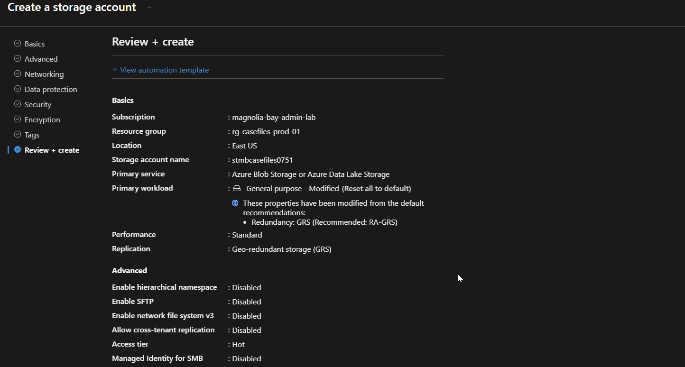
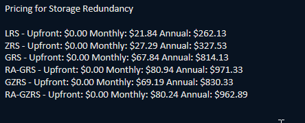
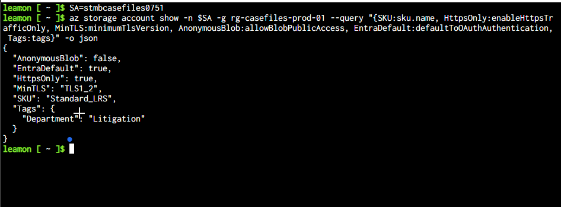

---

### Task 2 – Containers and data-plane access (R2)

**Management plane vs. data plane:** the management plane handles creating, configuring, and managing resources; the data plane handles the data inside them. Owner and Contributor are management-plane roles. Reading or writing **files** requires a **Storage Blob Data** role.

| Group | Role | Scope | Purpose |
|---|---|---|---|
| `SG-Paralegals-All` | Storage Blob Data Contributor | `case-files` | Add and update case files |
| `SG-Litigation-Team` | Storage Blob Data Reader | `case-files`, `exhibits-henderson` | Read case files and exhibits |
| `SG-Litigation-Team` | Reader | Storage account | Find the account in the portal (management plane only) |

```bash
az role assignment create --assignee-object-id "$PARA" --assignee-principal-type Group \
  --role "Storage Blob Data Contributor" --scope "$CF" \
  --description "P03-R2 Paralegals add and update case files"

az role assignment create --assignee-object-id "$LIT" --assignee-principal-type Group \
  --role "Reader" --scope "$ACCT_ID" \
  --description "P03-R2 Portal visibility of the case files account (management plane only)"
```

**Why container scope:** a future container for another department doesn't inherit litigation access.

**Why the extra Reader role:** data roles alone let someone read files through the CLI or AzCopy, but the portal can't find the account without a management-plane role. That's ticket T1 in reverse.

**Note:** paralegals don't need a separate Reader assignment, because the only paralegal (Tasha) is also on the litigation team. A paralegal outside litigation would have data access but no way to browse to it in the portal.

**Owner ≠ data access:** creating a container worked as Owner, because it only needs `containers/write`, an **Action** covered by Owner's `*`. Uploading or listing **blobs** failed with `AuthorizationPermissionMismatch`, because those are **DataActions**. After assigning myself a data role, the same command succeeded.

**Auditing gap:** the storage account's **Access control (IAM)** page shows assignments at the account and above, but **not** container-level ones. A complete audit needs `az role assignment list --all` or each container's IAM page.

| Test | Expected | Result |
|---|---|---|
| Container public access option | Unavailable | ✅ |
| Tasha uploads to `case-files` | Succeeds | ✅ |
| Marcus reads `case-files` | Succeeds | ✅ |
| Marcus uploads | Fails | ✅ |
| Owen opens the storage account | No access | ✅ |
| Owner uploads a blob with Entra auth, no data role | Fails | ✅ |
| Owner, after a data role is assigned | Succeeds | ✅ |

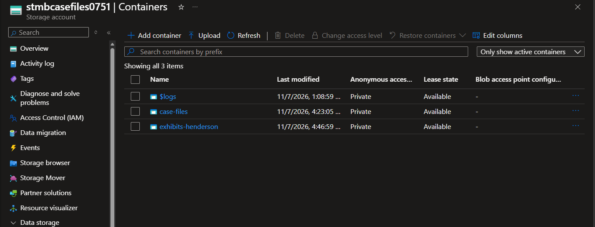
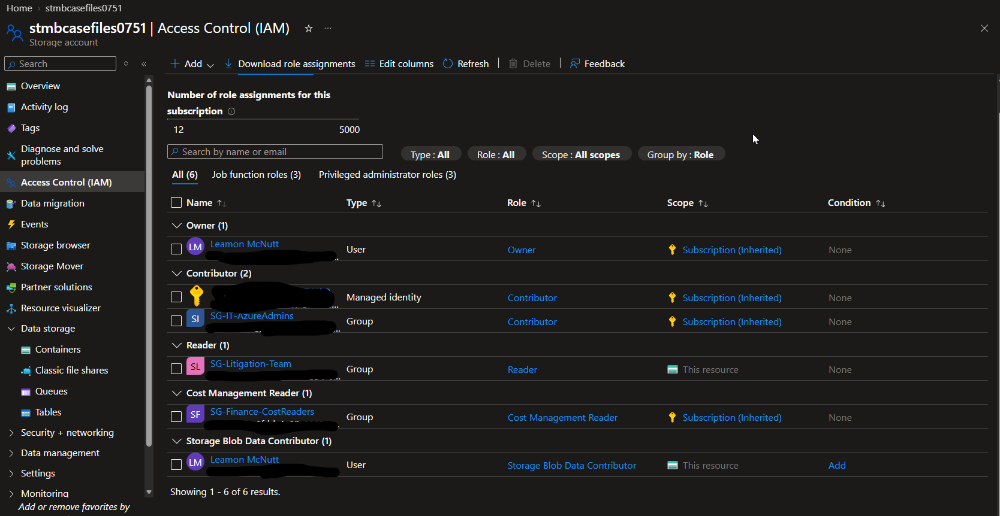
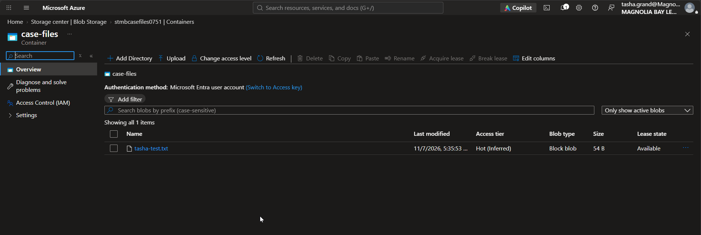
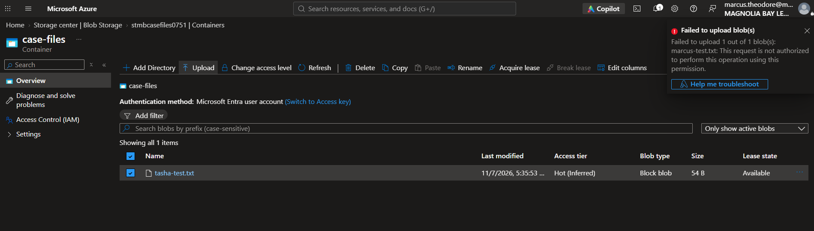
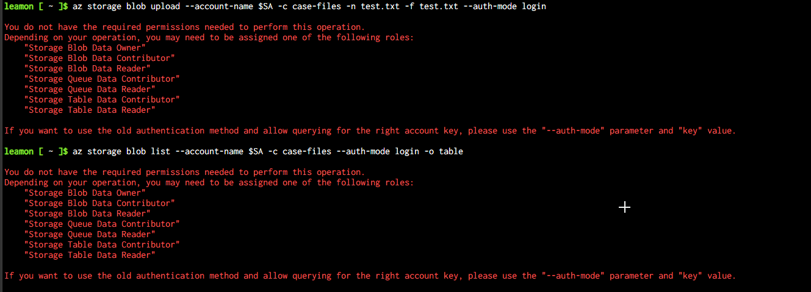
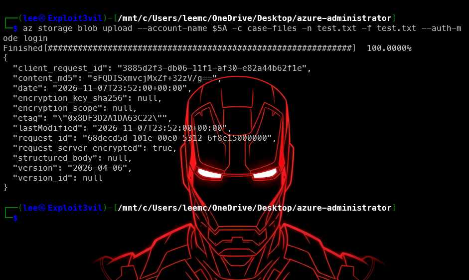

---

### Task 3 – Migrate with AzCopy (R3)

AzCopy is how large migrations are done: parallel, resumable, scriptable. I signed in with **Entra ID**, not the account key:

- **Conditional Access applies:** Entra sign-in triggers MFA. A key bypasses Conditional Access entirely.
- **Traceability:** uploads are made as me. A key has no identity attached.
- **RBAC:** my access is limited to my roles and ends when the role is removed. A key opens the whole account until it's rotated.
- **No secret to leak:** keys end up in scripts, shell history, tickets, and git commits.

```bash
export AZCOPY_AUTO_LOGIN_TYPE=DEVICE      # AZCLI in Cloud Shell
export AZCOPY_TENANT_ID="$TENANT"

azcopy copy "$HOME/casefiles/*" "https://$SA.blob.core.windows.net/case-files/" --recursive
azcopy sync "$HOME/casefiles" "https://$SA.blob.core.windows.net/case-files" --recursive --dry-run
azcopy sync "$HOME/casefiles" "https://$SA.blob.core.windows.net/case-files" --recursive
```

- `copy` uploaded **4 files**.
- After one new file and one edited file, `sync` transferred **only those 2**. That's how a real migration works: a bulk sync while people keep working, then a short final sync at cutover.
- Recreating identical files in a new shell made `sync` plan to re-upload all of them, because it compares **last-modified times**, not content.
- `sync` doesn't delete from the destination by default. I'd always run `--dry-run` before enabling deletion.

**Finding: data operations aren't in the Activity log.** It showed only my role assignments and the container I created through Resource Manager. The blob uploads, and even the container I created through the blob endpoint, weren't there. **Right now the firm can't answer "who opened or deleted a case file?"** The fix is diagnostic settings sending *StorageRead / StorageWrite / StorageDelete* logs to Log Analytics (planned for Project 05).

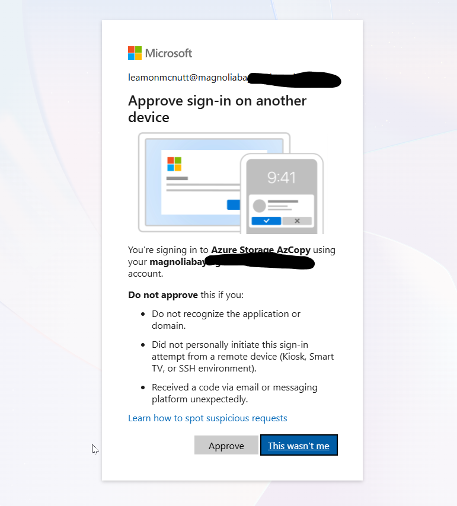
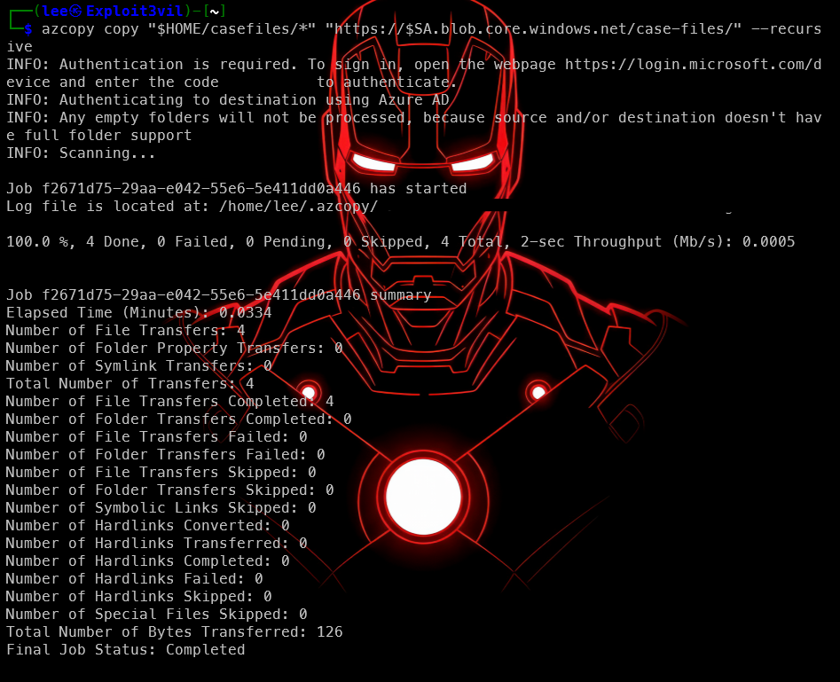
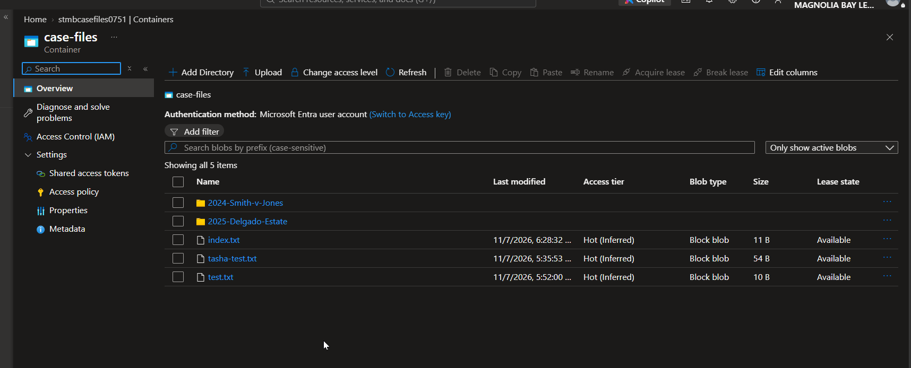
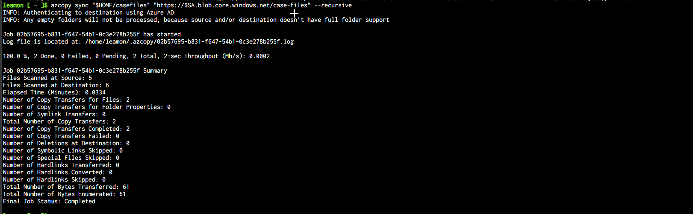

---

### Task 4 – Soft delete and versioning (R4)

| Setting | Default found | Configured |
|---|---|---|
| Blob soft delete | 7 days | **14 days** |
| Container soft delete | 7 days | **14 days** |
| Versioning | Off | **On** |

**Why 14 days:** mistakes aren't always caught right away. A deletion discovered after a long weekend and a busy week would be gone with 7-day retention.

**Soft delete vs. versioning vs. backup:** ✏️ *Add in your own words.* (Soft delete protects against deletion, versioning against overwrites, and neither is a backup, because both live in the same storage account.)

```bash
az storage account blob-service-properties update -n $SA -g $RG \
  --enable-delete-retention true --delete-retention-days 14 \
  --enable-container-delete-retention true --container-delete-retention-days 14
az storage account blob-service-properties update -n $SA -g $RG --enable-versioning true
```

| Test | Expected | Result |
|---|---|---|
| Delete a file (versioning off), then undelete | Restored | ✅ |
| Overwrite `index.txt`, restore the previous version | Original content back | ✅ |
| Delete a file **with versioning on**, then `undelete` | ? | ❌ Not restored |
| Same file: promote the previous version | Restored | ✅ |

**The restore procedure changes when versioning is on.** A delete turns the current version into a previous version, and `undelete` doesn't bring it back. The fix is **Make current version**. A help desk runbook that says "just click Undelete" breaks the day someone turns on versioning.

**Other observations:**
- `index.txt` had **one** version after the overwrite. Files written before versioning was enabled have no history.
- **Turn on versioning and soft delete before migrating data in**, not after.
- Previous versions **don't expire on their own** and are billed. The Task 5 lifecycle rule deletes them after 90 days.

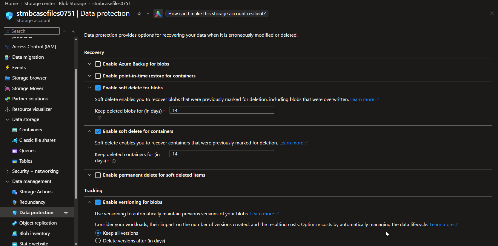
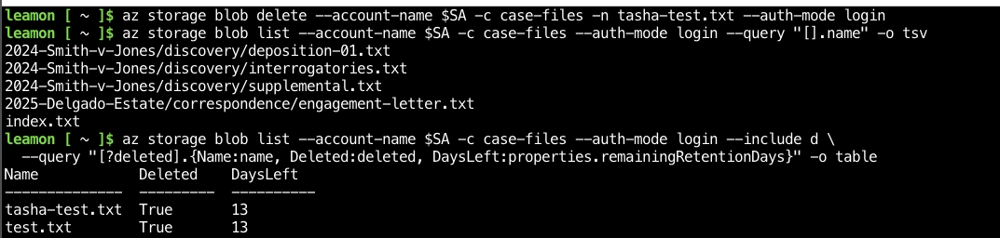
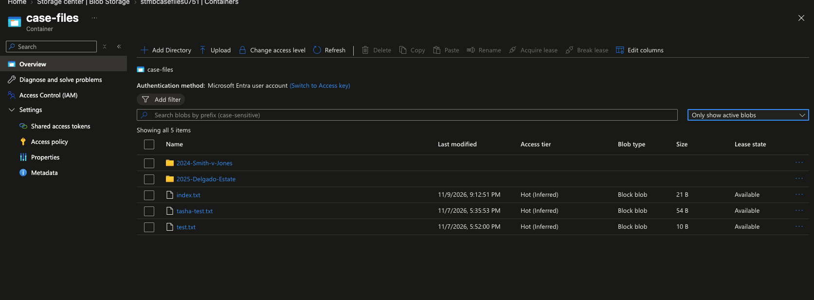
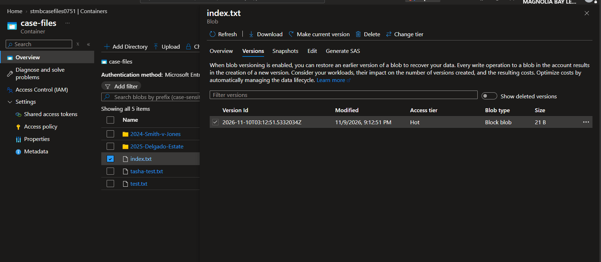
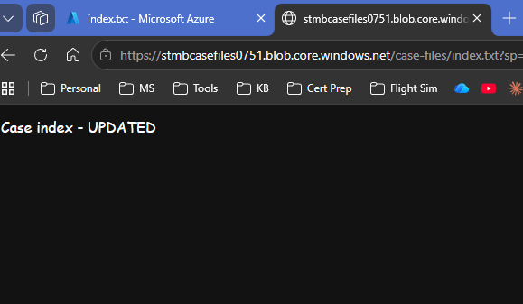
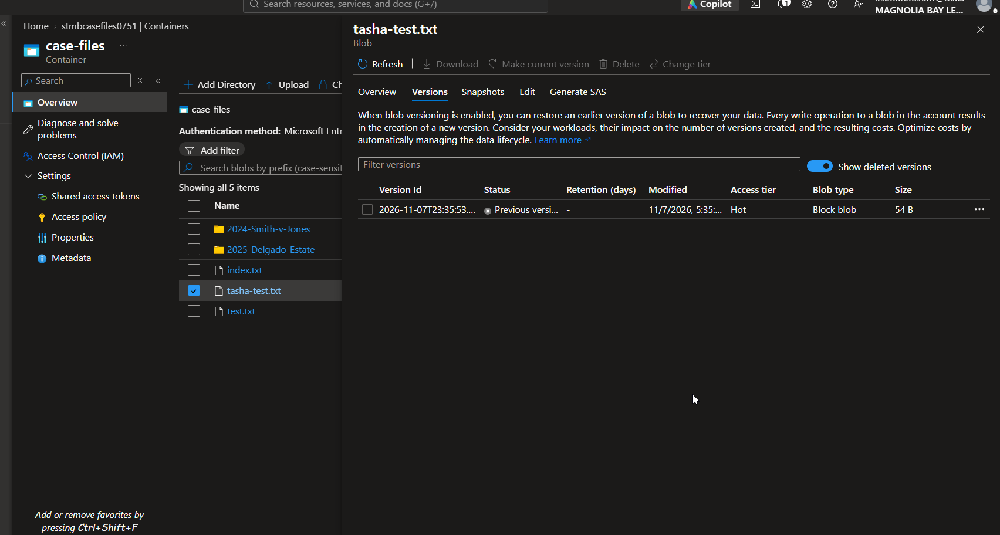

---

### Task 5 – Access tiers and lifecycle management (R5)

| Tier | Storage cost | Read cost | Minimum stay |
|---|---|---|---|
| Hot | Highest | Lowest | — |
| Cool | Lower | Higher | 30 days |
| Cold | Lower | Higher | 90 days |
| Archive | Lowest | Highest, **offline** | 180 days |

**Lifecycle rule `casefiles-retention`** (block blobs, prefix `case-files/`):

| Applies to | Condition | Action |
|---|---|---|
| Base blobs | ✏️ *Last modified / accessed* > 30 days | Move to Cool |
| Base blobs | ✏️ *Last modified / accessed* > 180 days | Move to Archive (skip blobs rehydrated in the last ✏️ __ days) |
| Base blobs | Last modified > 2,555 days (7 years) | Delete |
| Versions | Created > 90 days | Delete |

**Design decisions:**
- **Prefix filter `case-files/`:** without it, the rule would also target `exhibits-henderson`, the legal hold container.
- **Skip recently rehydrated blobs:** without it, the daily lifecycle run would re-archive a file right after we paid to rehydrate it, because rehydration doesn't change the last-modified date.
- **Limitation:** the rule counts 7 years from the last change to a file, but legal retention usually runs from when the **case closed**. A production fix is a blob index tag (e.g., `caseStatus=closed`) that the delete rule filters on.

The rule is exported to [`lifecycle-policies/lifecycle-casefiles.json`](lifecycle-policies/lifecycle-casefiles.json), with the subscription ID removed.

**Archive test:** I archived `test.txt` and tried to download it. The download failed: archived blobs are **offline**. I started a **Standard** rehydration (up to 15 hours). ✏️ *Rehydration result and time.*

**What I learned:** frequently used files belong in Hot. Set sensible thresholds before files move to Archive, because reading archived files costs more and means waiting hours for rehydration.

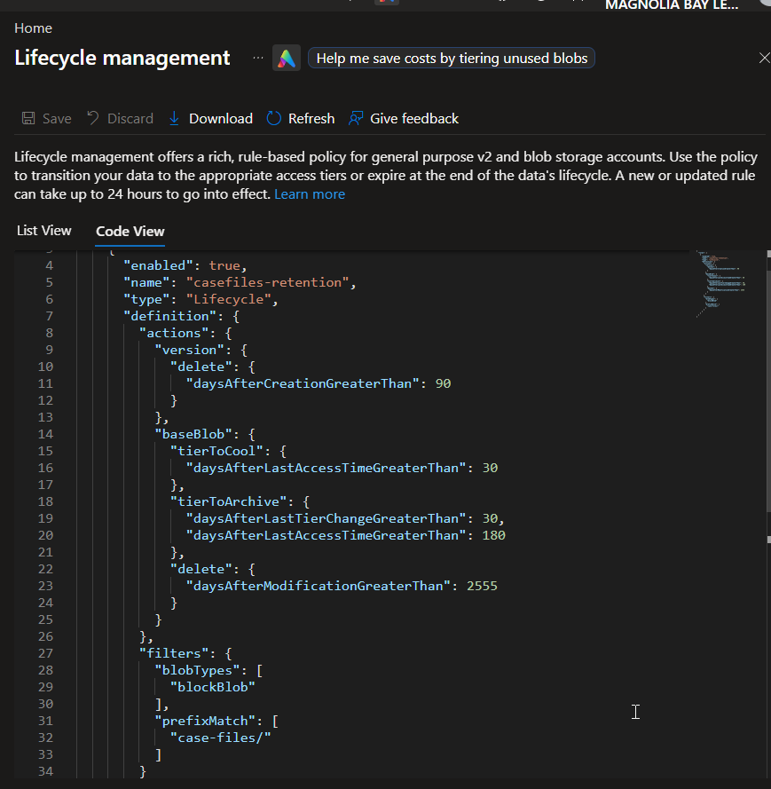
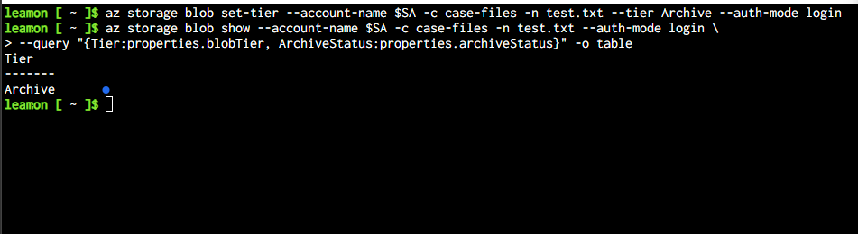
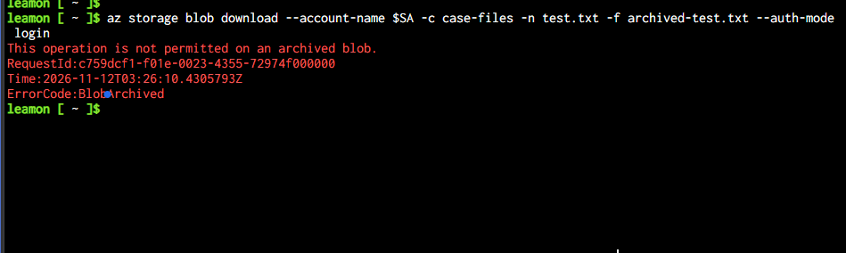
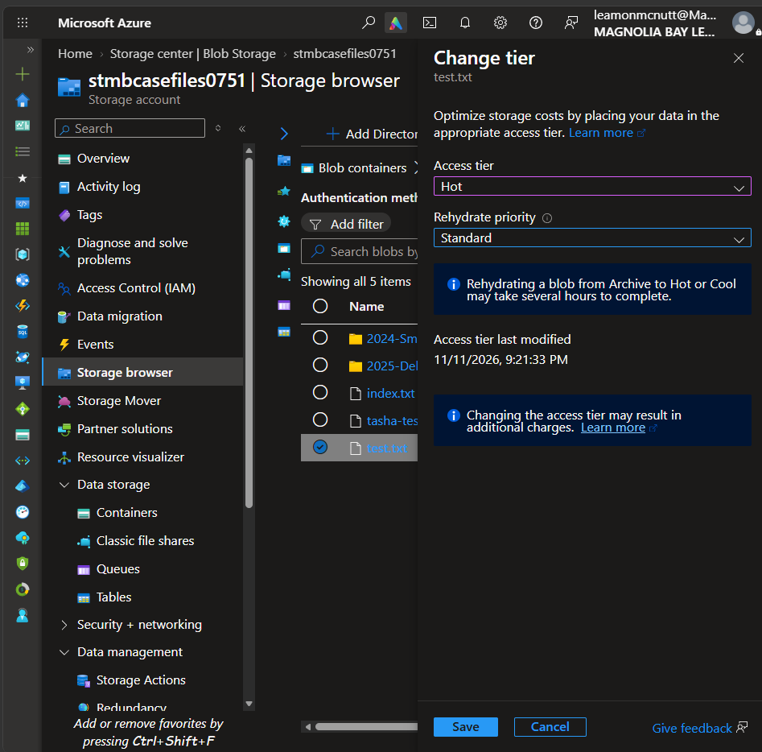

---

### Task 6 – Litigation hold (R6)

A **legal hold** puts data in a **WORM** (write once, read many) state. Blobs can be created and read, but **not modified or deleted**, until the hold is cleared. It's enforced by the storage service, so it applies to Entra RBAC, the account key, and SAS alike.

**Legal hold vs. time-based retention:** a time-based policy locks data for a fixed period and expires automatically; a legal hold lasts until it's manually cleared. Both prevent modification and deletion, and they can coexist. **I didn't create a locked time-based policy**, because a locked policy can't be removed, and the data and account couldn't be deleted until it expired.

```bash
az storage container legal-hold set --account-name $SA -g $RG \
  --container-name exhibits-henderson --tags henderson
```

| Test | Expected | Result |
|---|---|---|
| Delete a held file (as Owner) | Fails | ✅ Blocked |
| Overwrite a held file | Fails | ✅ Blocked |
| Delete with the **account key** | Fails | ✅ Blocked ✏️ *confirm* |
| Upload a **new** file | My prediction: fails | Allowed. New evidence can still be added during discovery. |

**What went wrong first** (see the [Troubleshooting Log](#7-troubleshooting-log)): an "overwrite" succeeded, because the original had been uploaded as `exhibits-a.txt` and the overwrite targeted `exhibit-a.txt`, a name that didn't exist. It **created** a new blob. Both mistakes are now in the held container and **can't be removed until the hold is cleared**. **Lesson: stage and verify evidence before applying the hold.**

**Governance:** Owner and Contributor can clear a hold. The protection against an insider is the hold's own **audit log** (who set or cleared it, when, and which tags), the Activity log, and a process requiring attorney approval. A locked time-based policy is the stronger technical control.

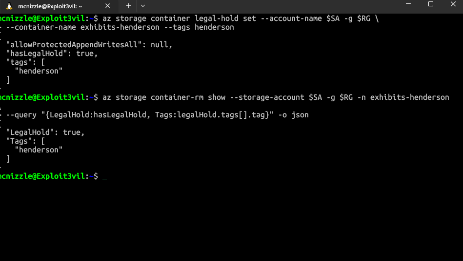
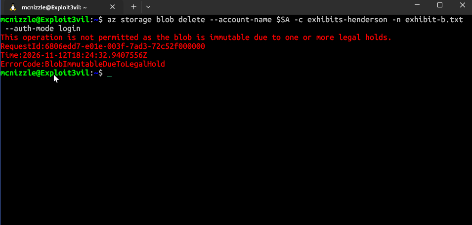
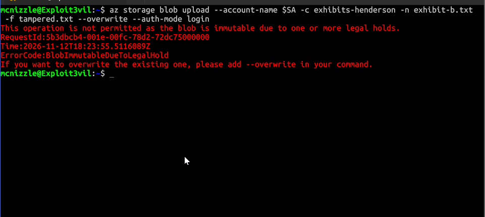

---

### Task 7 – Share one exhibit with co-counsel (R7)

| Setting | Value |
|---|---|
| Type | **User delegation SAS**, signed with my Entra credentials |
| Resource | One blob: ✏️ *`exhibits-a.txt` or `exhibit-b.txt`* |
| Permissions | Read only (`sp=r`) |
| Expiry | 48 hours, with no start time (avoids clock-skew failures) |
| Protocol | HTTPS only |

```bash
az storage blob generate-sas --account-name $SA -c exhibits-henderson -n <blob> \
  --permissions r --expiry "$EXPIRY" --https-only --as-user --auth-mode login --full-uri -o tsv
```

**Account key SAS vs. user delegation SAS:** a user delegation SAS uses Entra credentials and RBAC, is logged under my identity, and can't grant more than I'm allowed. An account key SAS relies only on the key, which gives full access and can only be revoked by rotating the key.

**SAS vs. Project 01 guest access:** ✏️ *Add when you'd use each.* (Guest: ongoing collaboration, with an identity and attributable actions. SAS: one file, short term, no account, but anyone holding the link has access.)

| Test | Expected | Result |
|---|---|---|
| Link in InPrivate (not signed in) | Downloads | ✅ 200 |
| Same token, a different file | Denied | ✅ 403 (signature covers the exact path) |
| Same token, list the container | Denied | ✅ 403 (`sr=b`: one blob only) |
| Same token over HTTP | Denied | ✅ **400** (see below) |
| After revocation | Denied | ✅ ✏️ *confirm* |

**400, not 403, for HTTP:** the request was rejected with `AccountRequiresHttps` by the **account-level** secure transfer setting before the SAS was evaluated. HTTP is blocked by two separate controls.

**Revocation:** `az storage account revoke-delegation-keys` revokes **every** user delegation SAS on the account. A user delegation SAS also stops working when the **signer** loses data access, so removing my migration role would have revoked it too.

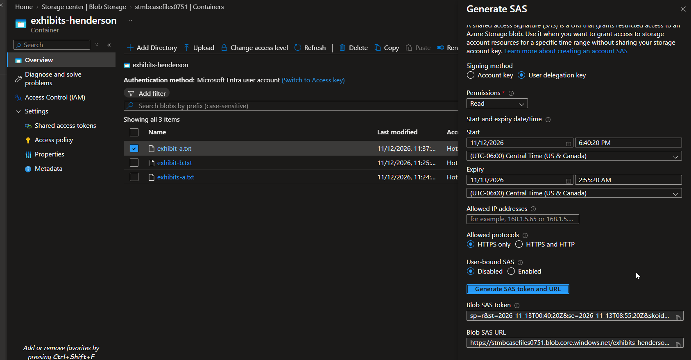
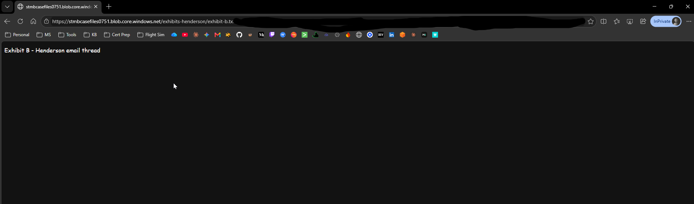
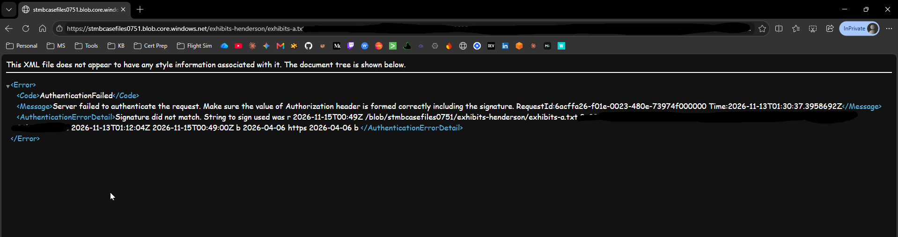

---

### Task 8 – Azure Files for the front office, and the lock (R8)

**Share:** `office-shared`, 10 GiB quota, Transaction optimized tier.

| Test | Expected | Result |
|---|---|---|
| Delete a file, restore from a snapshot | Restored | ✅ |
| Map the drive from Windows | Mounted | ❌ Port 445 blocked |
| Delete `rg-casefiles-prod-01` | `ScopeLocked` | ✅ |

**Snapshots:** Azure Files has no per-file soft delete or versioning, so a snapshot is how a deleted file comes back. In production, **Azure Backup for Azure Files** would take them on a schedule.

**Port 445 (ticket T5):**

| Port | Result |
|---|---|
| 445 (SMB) | ❌ `TcpTestSucceeded : False` |
| 443 (HTTPS) | ✅ `True` |

Same host and IP, so outbound SMB is blocked on this network, most likely by the ISP. A failed ping means nothing here: Azure Storage doesn't respond to ICMP.

**Finding: the Connect script stores the account key on every PC.** The portal's script runs `cmdkey`, which saves the **storage account key** in Windows Credential Manager. That key opens the **entire account**, including `case-files` and `exhibits-henderson`, and bypasses all of Task 2's RBAC. Anyone who compromises a front-office PC could read it with `cmdkey /list`. **Fixes:** a **separate storage account** for front-office files, and **identity-based access** (Microsoft Entra Kerberos) so no key is stored, followed by disabling account key access.

**Lock `lock-nodelete-casefiles`:** soft delete, versions, snapshots, and the legal hold all live inside the storage account. Deleting the account would take them all with it. The lock protects the container that all that protection lives in, the same idea as Diane's request in Project 02.

**Lock side effect:** a CanNotDelete lock also blocks **removing role assignments** in its scope, because role assignments are child resources of that scope. Removing my temporary migration role required lifting the lock first.

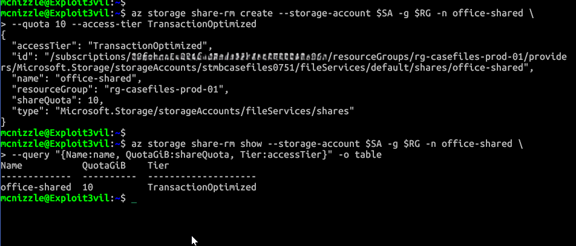
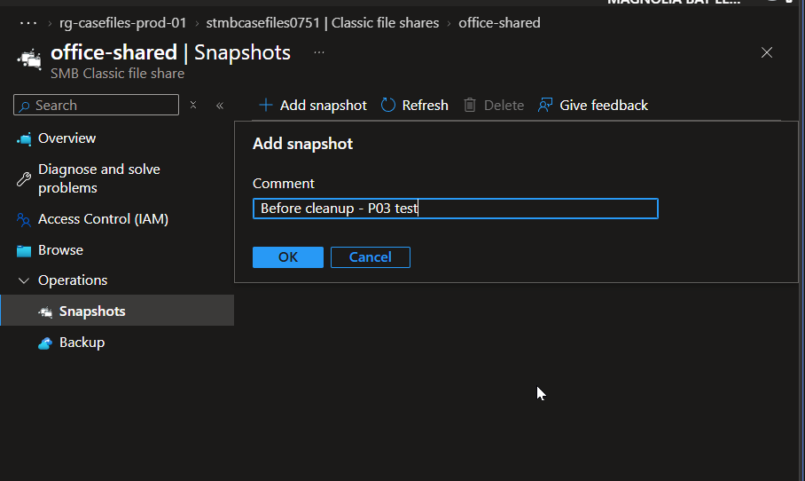
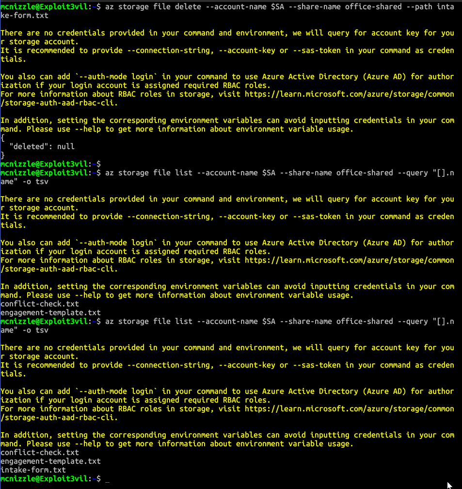
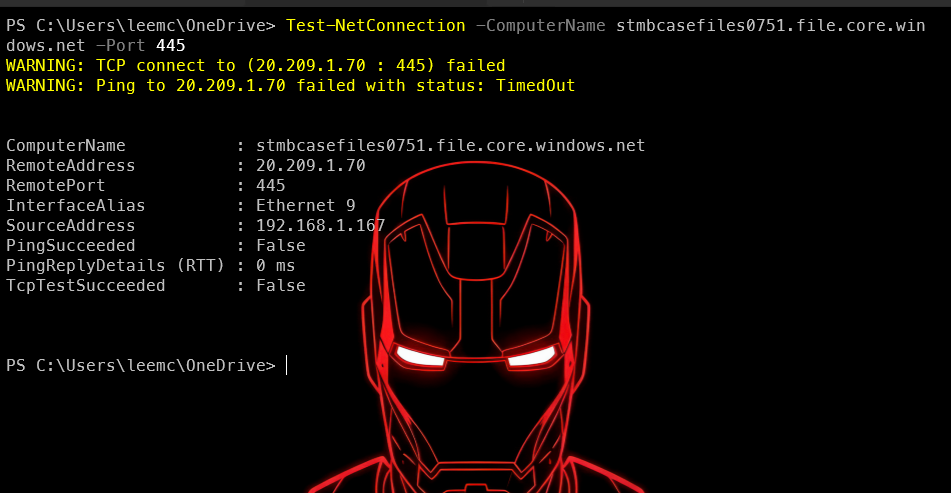

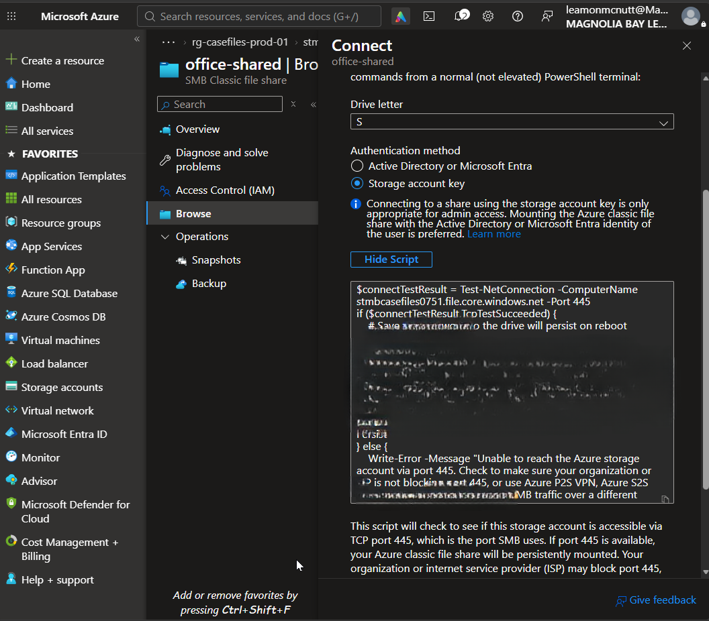
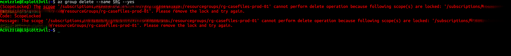

---

## 5. Validation

| Test | Expected | Result |
|---|---|---|
| Storage account tags | `Department=Litigation` inherited | ✅ |
| Container public access | Not possible | ✅ |
| Tasha uploads / Marcus reads / Marcus uploads / Owen | ✅ / ✅ / ❌ / no access | ✅ |
| Owner reads blobs without a data role | Fails | ✅ |
| AzCopy with Entra sign-in; sync moves only changes | Succeeds | ✅ |
| Deleted file restored; overwritten file restored | Restored | ✅ |
| Read an archived blob | Fails until rehydrated | ✅ |
| Delete or overwrite under legal hold (Owner and key) | Fails | ✅ |
| SAS: works / other file / list / HTTP / revoked | 200 / 403 / 403 / 400 / denied | ✅ |
| File restored from share snapshot | Restored | ✅ |
| Delete `rg-casefiles-prod-01` | `ScopeLocked` | ✅ |
| Upload with Entra after removing my migration role | Fails | ✅ ✏️ *confirm* |

---

## 6. Troubleshooting Tickets

**T1 – "I can see the storage account, but it says I'm not authorized to see the files."**
They have a management-plane role (e.g., Reader) but no data role. Reader shows the account; reading files needs Storage Blob Data Reader (or a File Data role for file shares). Also check the portal's **Authentication method**, and allow a few minutes for new roles to apply.

**T2 – "Co-counsel says the link doesn't work."**
Check, in order: expired? revoked (delegation keys revoked)? start time ahead of their clock? the right blob and read permission? did the **signer** lose their data role? was the link truncated when copied? Plain HTTP returns 400.

**T3 – "I can't open the deposition from 2019."**
It's in Archive, which is offline. Rehydrate to Hot: **Standard** (up to 15 hours, cheaper) or **High** (usually under an hour, more expensive). If it's needed for court tomorrow, High is worth the cost. That's the attorney's decision, not just IT's.

**T4 – "Azure won't let me delete an old exhibit."**
It's under a legal hold (also check for a resource lock). A hold blocks everyone. IT can technically clear it, but shouldn't without the responsible attorney's written approval, and the hold's audit log records who cleared it.

**T5 – "The shared drive won't map."**
I reproduced this. `Test-NetConnection` to port 445 failed while 443 to the same endpoint succeeded, so outbound SMB is blocked on the network. Options: a VPN to Azure (Project 05), Azure File Sync with a local server, asking the ISP to unblock 445, or the portal and Storage Explorer (HTTPS) in the meantime.

---

## 7. Troubleshooting Log

| # | Task | Issue | What I checked | Root cause | Fix |
|---|---|---|---|---|---|
| 1 | 2 | Owner created a container with `--auth-mode login`; expected to fail | Signed-in identity, all role assignments (inherited + groups), storage environment variables | Create Container needs only `containers/write`, an **Action** in Owner's `*`. Blob read/write are **DataActions**, which Owner lacks. | Retested with a blob upload and list, which failed as expected |
| 2 | 2 | WSL session signed in as a different-looking UPN than earlier Activity log entries | User lookup by object ID | My admin account's UPN had been changed. Logs record the name at the time of the event. | Confirmed one account by object ID. Investigations should correlate by object ID, not name. |
| 3 | 3 | AzCopy: all 4 transfers failed after a successful `azcopy login` | The job log: **401 NoAuthenticationInformation** (the request reached the account, but no credentials were sent) | The login token wasn't persisted in WSL (no keyring) | `AZCOPY_AUTO_LOGIN_TYPE=DEVICE` (later `AZCLI`) with the tenant ID, so each command signs in itself |
| 4 | 3 | `\r` in captured values when using WSL | `which -a az` | WSL was running the Windows `az.exe` | Installed the Linux Azure CLI in Ubuntu; verified with `echo "[$VAR]"` |
| 5 | 6 | "Overwrite" under a legal hold succeeded | Hold status (on); the version list showed one 9-byte version and no original | The original was uploaded as `exhibits-a.txt`, so `--overwrite` on `exhibit-a.txt` **created** a new blob, which a legal hold allows. My first assumption (versioning allowed overwrites) was disproved by the version list. | Retested against an existing blob; overwrite and delete were blocked |
| 6 | 7 | SAS worked on a "different" file (200) | Compared the original and modified URL paths | The `sed` substitution didn't match the current `SAS_URL`, so both tests used the same valid link | Fixed the substitution and printed both paths before testing: 403 |
| 7 | 8 | Portal: "You do not have permissions to list the data" on the file share snapshot | Authentication method was Microsoft Entra user account; my roles | The portal defaults to Entra auth (Task 1 setting). Blob data roles don't cover Azure Files, which needs **Storage File Data Privileged** roles. | Switched to Access key for the restore |
| 8 | 8 | `ScopeLocked` when removing my migration role | The scope path in the error | Role assignments are child resources of their scope, so the RG's CanNotDelete lock blocked deleting them | Removed the lock, deleted the role, re-applied the lock. Runbook: remove temporary access before locking. |

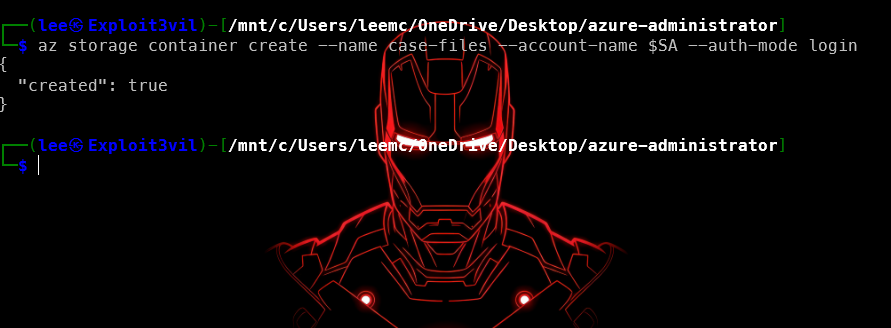
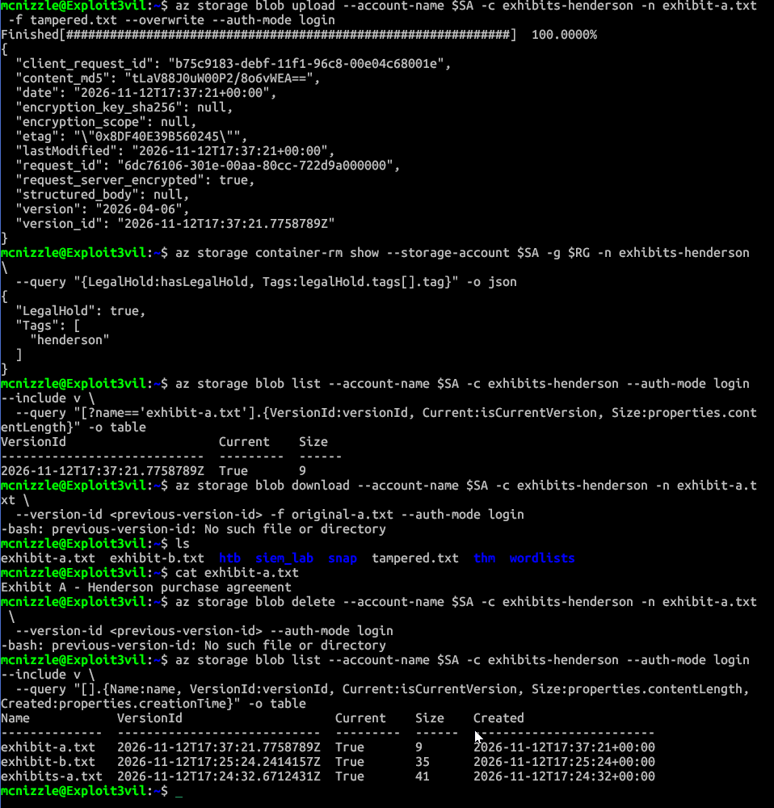
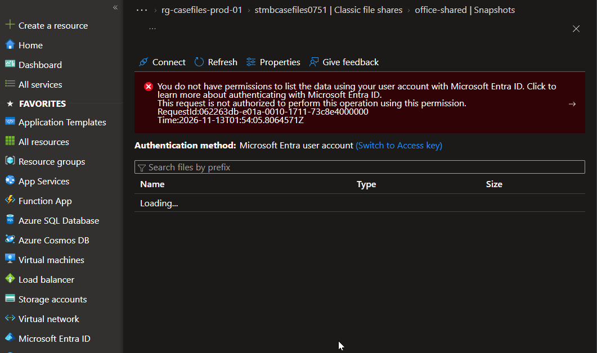
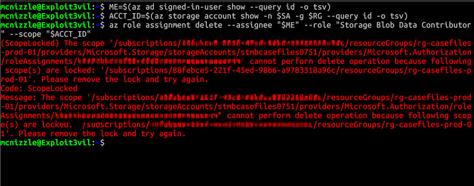

---

## 8. Why I Made These Choices

> ✏️ *Draft. Rewrite in your own words.*

- **LRS for the lab, GRS recommended for production:** cost in the lab; availability of the firm's only copy in production.
- **Container-scoped data roles:** each team gets exactly the files its job needs, and new containers don't inherit access.
- **Entra sign-in for the migration:** MFA applies, actions are attributable, and no key ends up in a script.
- **14-day soft delete:** mistakes aren't always noticed within a week.
- **Lifecycle rule scoped to `case-files/`:** retention rules shouldn't target held evidence.
- **Legal hold instead of a locked retention policy:** matches how litigation holds work and can be cleared at the end of the case.
- **User delegation SAS:** one file, read-only, short expiry, tied to my identity, revocable without rotating keys.
- **Lock on the resource group:** every recovery feature lives inside the account.

---

## 9. Lessons Learned

> ✏️ *Add your own.*

- Owner and Contributor don't include data access, and Blob data roles don't include Azure Files.
- The restore procedure depends on which features are enabled. Test recovery steps; don't just document them.
- The Activity log doesn't record data-plane activity, so storage access needs its own logging.
- Verify a test's inputs and starting state before trusting its result. Three "failures" in this project were test setup mistakes.
- An account key anywhere (a script, a PC's credential store) is access to the entire account.

---

## 10. Cleanup & Cost

- [x] Temporary migration role removed
- [ ] Legal hold: ✏️ *kept on, or cleared before deleting held test data*
- [ ] `test.txt` rehydration confirmed or the blob deleted
- [ ] Share snapshots kept or deleted on purpose
- [x] Lock removal documented (lifted briefly to remove my migration role, then re-applied)
- [ ] Actual cost from Cost Management: $____

> **For future teardowns:** remove the lock, clear the legal hold, then delete. Remove temporary access before applying locks.

---

## Interview Talking Points

- Management plane vs. data plane, and why Owner can't read blobs by default
- LRS vs. ZRS vs. GRS, and why I'd choose differently for the lab and the firm
- Soft delete vs. versioning vs. snapshots vs. backup
- Access tiers, rehydration, and early-deletion charges
- Legal hold vs. time-based retention, and why I never locked a policy in a lab
- Account key vs. user delegation SAS, and SAS vs. guest access
- Blob vs. Azure Files, and why the Connect script's stored key is a security risk
